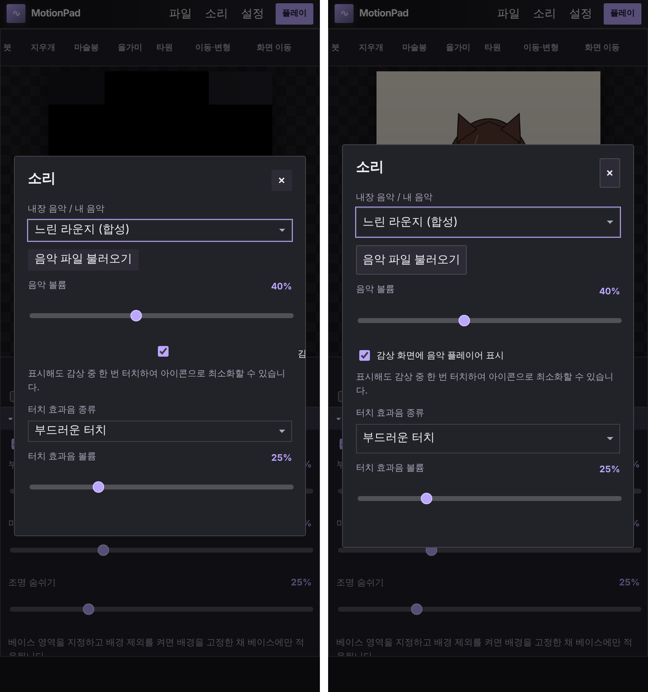
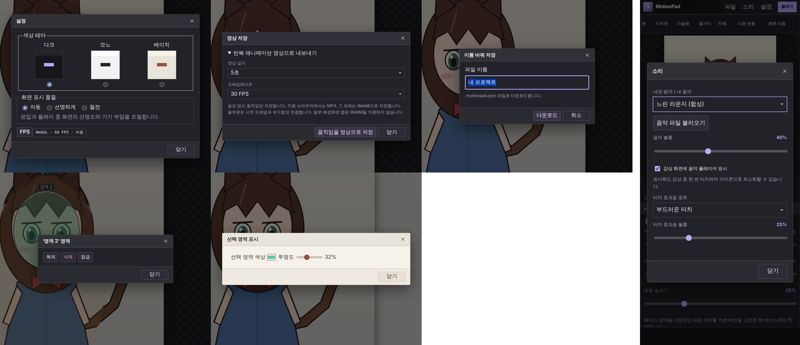

# 0-4b 디자인 개선

방향(청사진 결정 기록): 포토샵·클립스튜디오의 색이 아니라 레이아웃·디자인 특색을 차용한다. 메뉴 배치, 글꼴·아이콘 스타일, 서브메뉴 구분선·분류 묶음선, 확인/닫기 버튼 등 정돈된 프로그램 느낌. 테마 후보는 미정(A: 다크/라이트 검은 포인트/종이 감성, B: 다크/라이트 베이직/모노).
진행 원칙: 시안을 따로 만들지 않고 실제 프로그램에 바로 적용한다. 단계마다 스크린샷으로 보여 주고, 기능 회귀는 측정기로 확인한다(저장·선택·동작 시험·속성 동등성).

## 1. 어색한 점 정리
- 버튼에 얇은 테두리(--line)를 보이게 했다. 원본은 규칙 겹침 때문에 테두리가 투명했다. 상단 메뉴 항목과 캔버스 아래 버튼은 평평한 모양을 유지한다.
- '화면 이동' 탭만 작던 글자, 축 버튼 셋의 제각각인 글자 크기를 하나로 맞췄다. '그림에서 흐름 방향 지정' 버튼도 같은 모양으로 맞췄다.
- 소리 창 '감상 화면에 음악 플레이어 표시': 체크박스가 한 줄을 다 차지해 글자가 밀려나던 문제를 고쳤다(대화창 입력칸 규칙을 글자 입력칸에만 적용). 
- 터치 기기: 옵션 패널·대화창의 선택상자와 버튼을 36px 높이로 키워 누르기 쉽게 했다.
- 영역 칩('영역 1' 같은 이름 버튼): 밑줄 글자에서 테두리 있는 버튼 모양으로 바꿔, 누를 수 있는 것임이 보이게 했다. 몸체 영역은 점선 테두리.
- 모노 테마: 캔버스 바탕색을 토큰(--stageInk)으로 옮기고, 활성 도구 탭과 빈 영역 안내를 다른 테마와 같은 모양으로 맞췄다.
- 검증: 저장 왕복·선택 결과·동작 시험·속성 동등성 모두 이전과 같음, 오류 0건.

## 2. 대화창 틀 통일
- 모든 대화창(파일·영상·소리·설정·선택 영역 표시·이름 바꿔 저장·영역 메뉴·눈 깜빡임)을 같은 구조로: **제목줄**(제목 + 오른쪽 ×) · **내용** · **버튼줄**(오른쪽 정렬, 확인 계열 먼저 + 닫기/취소).
- 설정형 창에도 아래쪽 '닫기' 버튼을 두어 폰에서 작은 × 를 찾지 않아도 되게 했다. '영상으로 저장'·'다운로드' 같은 실행 버튼은 버튼줄로 옮겼다.
- 창이 열릴 때 초점은 내용 영역으로(× 에 테두리가 생기지 않게). 이름 바꿔 저장은 이름 칸에 초점.
- 테마 고르기의 이름 정렬이 흐트러지던 것도 바로잡았다.
- 검증: 다른 이름으로 저장 다운로드, ×·닫기로 닫힘, 선택 영역 표시가 패널로 돌아옴, 저장·선택·동작 시험·속성 동등성 모두 이전과 같음, 오류 0건.

