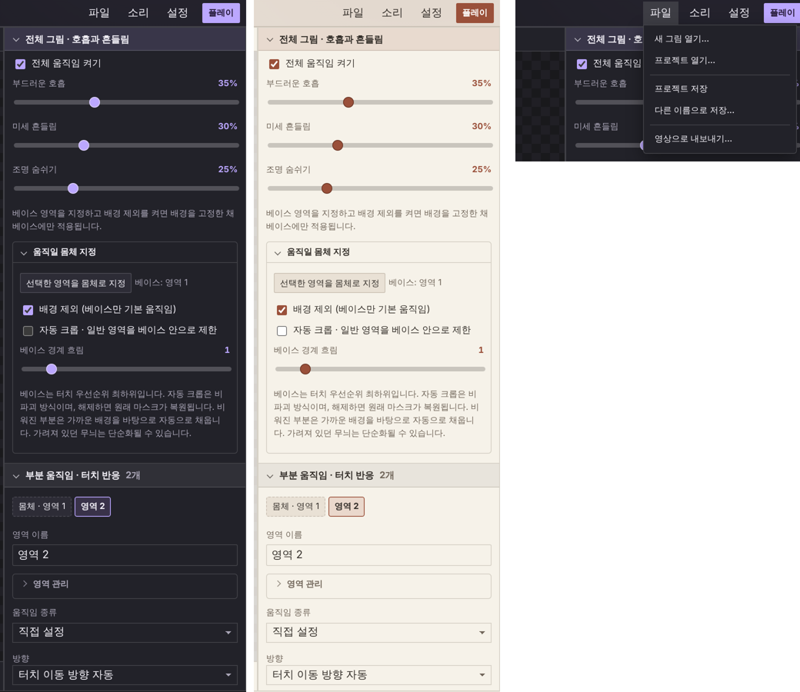
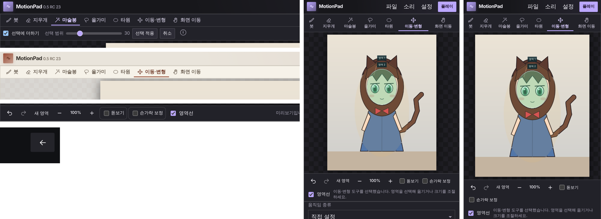
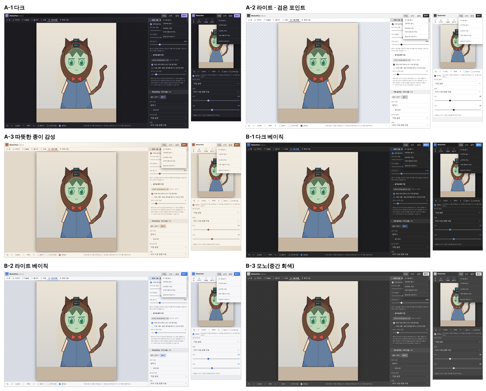
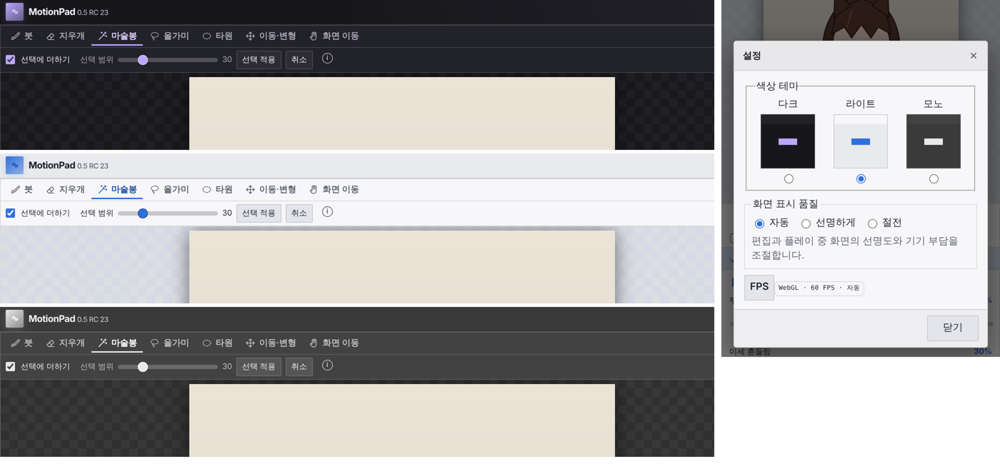

# 0-4b 디자인 개선

방향(청사진 결정 기록): 포토샵·클립스튜디오의 색이 아니라 레이아웃·디자인 특색을 차용한다. 메뉴 배치, 글꼴·아이콘 스타일, 서브메뉴 구분선·분류 묶음선, 확인/닫기 버튼 등 정돈된 프로그램 느낌. 테마 후보는 미정(A: 다크/라이트 검은 포인트/종이 감성, B: 다크/라이트 베이직/모노).
진행 원칙: 시안을 따로 만들지 않고 실제 프로그램에 바로 적용한다. 단계마다 스크린샷으로 보여 주고, 기능 회귀는 측정기로 확인한다(저장·선택·동작 시험·속성 동등성).

## 1. 어색한 점 정리
- 버튼에 얇은 테두리(--line)를 보이게 했다. 원본은 규칙 겹침 때문에 테두리가 투명했다. 상단 메뉴 항목과 캔버스 아래 버튼은 평평한 모양을 유지한다.
- '화면 이동' 탭만 작던 글자, 축 버튼 셋의 제각각인 글자 크기를 하나로 맞췄다. '그림에서 흐름 방향 지정' 버튼도 같은 모양으로 맞췄다.
- 소리 창 '감상 화면에 음악 플레이어 표시': 체크박스가 한 줄을 다 차지해 글자가 밀려나던 문제를 고쳤다(대화창 입력칸 규칙을 글자 입력칸에만 적용). 
- 터치 기기: 옵션 패널·대화창의 선택상자와 버튼을 36px 높이로 키워 누르기 쉽게 했다.
- 영역 칩('영역 1' 같은 이름 버튼): 밑줄 글자에서 테두리 있는 버튼 모양으로 바꿔, 누를 수 있는 것임이 보이게 했다. 몸체 영역은 점선 테두리.
- 모노 테마: 캔버스 바탕색을 토큰(--stageInk)으로 옮기고, 활성 도구 탭과 빈 영역 안내를 다른 테마와 같은 모양으로 맞췄다.
- 검증: 저장 왕복·선택 결과·동작 시험·속성 동등성 모두 이전과 같음, 오류 0건.

## 2. 대화창 틀 통일
- 모든 대화창(파일·영상·소리·설정·선택 영역 표시·이름 바꿔 저장·영역 메뉴·눈 깜빡임)을 같은 구조로: **제목줄**(제목 + 오른쪽 ×) · **내용** · **버튼줄**(오른쪽 정렬, 확인 계열 먼저 + 닫기/취소).
- 설정형 창에도 아래쪽 '닫기' 버튼을 두어 폰에서 작은 × 를 찾지 않아도 되게 했다. '영상으로 저장'·'다운로드' 같은 실행 버튼은 버튼줄로 옮겼다.
- 창이 열릴 때 초점은 내용 영역으로(× 에 테두리가 생기지 않게). 이름 바꿔 저장은 이름 칸에 초점.
- 테마 고르기의 이름 정렬이 흐트러지던 것도 바로잡았다.
- 검증: 다른 이름으로 저장 다운로드, ×·닫기로 닫힘, 선택 영역 표시가 패널로 돌아옴, 저장·선택·동작 시험·속성 동등성 모두 이전과 같음, 오류 0건.

## 3. 메뉴 구분선과 옵션 패널 묶음선
- 상단 메뉴: 묶음 사이 구분선(열기 | 저장 | 내보내기, 화면 설정 | 선택 영역 표시). 창이나 파일 선택을 여는 항목에는 '…'를 붙였다(포토샵·클립스튜디오 관례). 항목 높이·여백을 넓히고, 마우스를 올리면 포인트 색으로 칠한다.
- 옵션 패널: 큰 묶음(전체 그림, 부분 움직임)은 **패널 머리줄**, 그 안의 작은 묶음(몸체 지정, 영역 관리, 세부 설정, 효과 조합, 바람, 축·스프링)은 **테두리 상자 + 작은 제목**으로 구분했다. 접힘 표시는 글자 ▸▾ 대신 작은 꺾쇠 모양.
- 검증: 저장·동작 시험·속성 동등성 이전과 같음, 오류 0건.

## 4. 아이콘
- 선 하나로 그린 작은 아이콘(SVG)을 파일 안에 직접 넣었다. 외부 파일이 필요 없고, 테마 색을 그대로 따른다.
- 도구 탭: 붓·지우개·마술봉·올가미·타원·이동·변형·화면 이동. PC는 아이콘 옆 글자, 좁은 폰은 아이콘 아래 글자.
- 캔버스 아래: 실행 취소·다시 실행·축소·확대. 감상 화면의 '편집으로 돌아가기'.
- 검증: 저장·동작 시험·속성 동등성 이전과 같음, 오류 0건.

## 5. 테마 후보 미리보기
- 후보 색은 배포본에 넣지 않고 `tools/design/theme-candidates.css`에만 둔다. `node tools/design/theme_preview.js <출력.png>`로 실제 화면(PC·폰 편집 화면, 파일 메뉴 펼침)에 입혀 한 장으로 모은다.
- A-1 다크(현재) · A-2 라이트·검은 포인트(현재 '모노') · A-3 따뜻한 종이 감성 / B-1 다크 베이직(무채색·파란 포인트) · B-2 라이트 베이직(밝은 회색·파란 포인트) · B-3 모노(중간 회색, 색 없음)

## 6. 테마 확정과 체크박스 색
- 사용자 선택: **다크(A-1, 보라 포인트) · 라이트(B-2, 밝은 회색·파란 포인트) · 모노(B-3, 중간 회색)**. 설정 창 이름도 다크·라이트·모노.
- 테마 값: `violet`(기본) · `light` · `mono`. 예전 저장값 `basic`·`teal`은 라이트로 이어받는다. 저장값이 없거나 모르는 값이면 다크.
- 체크박스·라디오가 모두 테마 색을 따른다. 원본은 색 지정이 `.toggle` 안에만 있어 '선택에 더하기'가 브라우저 기본 파랑이었다.
- 채택되지 않은 후보(검은 포인트, 종이 감성, 다크 베이직)는 `tools/design/theme-candidates.css`에 비교용으로 남겼다.
- 검증: 저장 왕복·선택 결과·동작 시험·속성 동등성 이전과 같음, 테마 이어받기 7가지 경우 확인, 오류 0건.

## 0-4b 마무리
- 기능 변화 없음. 화면 모양만 바뀌었다(의도한 변화라 기준선 스크린샷과는 다르다).
- 기준선(`docs/baseline/legacy-0.5rc23/`)은 원본 그대로 둔다. 이후 단계의 '겉모습 유지' 비교는 0-4b 끝 시점의 작업본을 새 기준으로 삼는다(아래 '다음 단계' 참고).
- 남은 디자인 과제(3단계 '완성도'로 넘김): 선택영역 목록 정식 디자인, 안내 문구 한 곳 통합, 남은 기본 확인 창(confirm) 제거, 단축키, hover 상태 정밀 점검.
