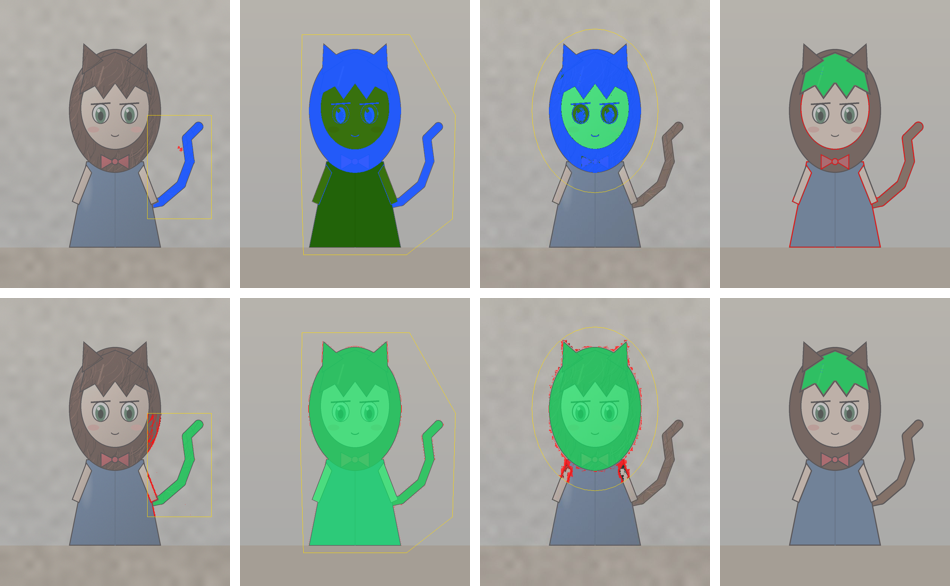
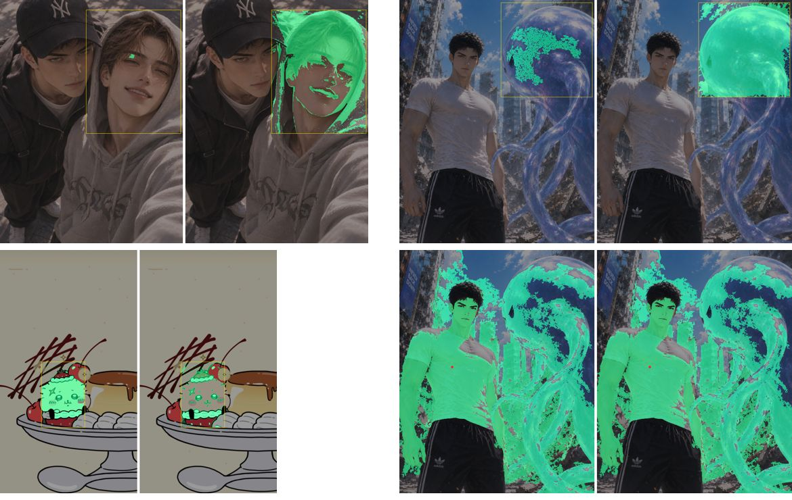
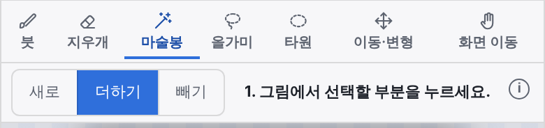
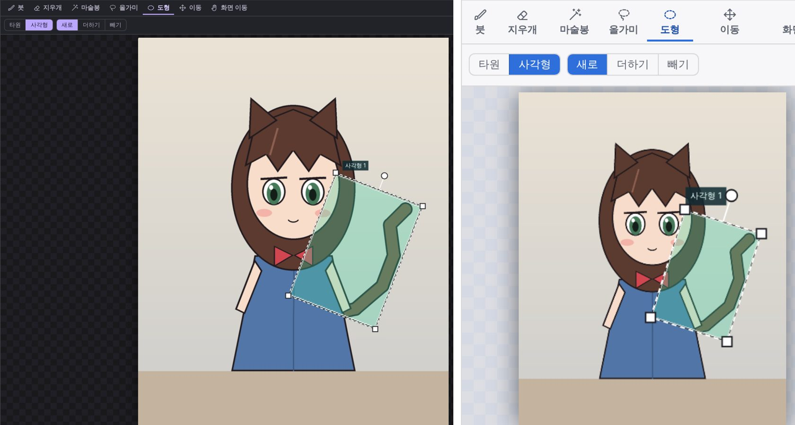

# 1-A 선택 알고리즘·선택 방식·도형/이동 도구 (완료)

## 측정 도구 (`tools/select/`)
- `make_set.py`: 같은 캐릭터 구도를 화풍 5종으로 그린 테스트 세트와 부위별 정답 마스크. 결정적이라 저장소에 넣지 않고 필요할 때 다시 만든다.
  - 평면(굵은 선) · 가는 선 · 음영(그라데이션·머리카락 결·하이라이트·잡티·질감 배경) · 선 없는 그림 · JPEG 압축 손상
- `bench.js`: 브라우저 없이 `src/js/select-core.js`의 계산 함수를 직접 돌려 IoU(정답과 겹친 정도, 100%가 완벽)를 잰다. 그림 5종 × 마술봉 8곳 + 간략 범위지정 6가지.
  - 마술봉: 한 번 눌렀을 때(앱이 자동으로 고른 범위)와 범위 슬라이더 최선값.
  - 간략 범위지정: 둘러싼 직후(범위 0)와 범위 슬라이더 최선값.
  - 정답 기준: 마술봉은 '누른 덩어리'(같은 색 이웃 부위·자기 외곽선은 채점 제외). 간략 범위지정은 '올가미 안에 온전히 들어온 부위'(올가미가 가로지른 옷·팔 조각은 원하지 않은 것으로 본다. 꼬리 뿌리처럼 둘러쌀 수 없는 곳은 예외).
  - `--images`로 결과 그림(초록=맞음, 빨강=넘침, 파랑=빠짐), `--base`로 이전 결과와 나란히 비교, `--core`로 다른 버전 함수 채점.
- `core-0.5.js`: 1-A 이전 계산 함수(비교 기준).
- 계산 함수를 `src/js/select-core.js`로 분리했다(화면과 무관한 순수 함수, 앱·작업 스레드·측정 도구가 함께 씀).

## 바꾼 것
1. **간략 범위지정**: '안쪽 한 점과 바깥 테두리의 경쟁' 방식을 버렸다. 이 방식은 선화 뒤 픽셀이 양쪽에서 똑같이 막혀 동점 → 탈락했다(머리카락·꼬리 통째 실패의 원인).
   - 올가미 테두리를 따라 색이 이어지는 구간을 묶고, 긴 구간(과 같은 색)을 **배경**으로 본다. 올가미가 물체를 가로지른 짧은 구간(꼬리 뿌리·선화)은 배경에서 빠진다.
   - 배경에서 **강한 경계를 넘어야 닿는 곳 = 대상**. 선화로 둘러싸인 안쪽은 저절로 메워진다(구멍 메우기).
   - 경계 기준값은 자동: 기준값별 넓이 곡선에서 배경 잡티를 넘은 뒤 처음 평평해지는 곳.
   - 올가미가 가로지른 덩어리는 닿은 길이가 크기(√넓이)보다 길면 뺀다(옷 옆면이 썰린 조각). 짧으면 남긴다(꼬리 뿌리).
   - 범위 슬라이더·남길 곳/뺄 곳 보정은 그대로 동작한다(점수 = 배경 장벽 − 자동 기준값).
2. **마술봉**: 선화(양옆 2~3칸보다 확연히 어두운 가는 줄)에는 들어갈 수만 있고 거기서 더 퍼지지 않는다. 자기 외곽선까지만 잡고, 외곽선을 타고 온몸으로 번지지 않는다. 누른 곳이 선화면 이 규칙을 끈다.
   - 범위 슬라이더를 끝까지 올렸을 때 선화에 막혀 닿지 못한 곳까지 잡히지 않도록 상한을 막았다.
   - 자동 범위 규칙은 여러 안(가장 평평한 곳, 첫 평평한 구간, 급증 직전, 최대 비율 급증, 기준 완화)을 시험했으나 모두 원래보다 나빠 **원래 규칙 유지**.

## 결과 (0-5 → 1-A, IoU 평균)
| 항목 | 이전 | 지금 |
|---|---|---|
| 간략 범위지정, 둘러싼 직후 | **28.9%** | **88.0%** |
| 간략 범위지정, 슬라이더 최선 | 84.5% | 92.6% |
| 마술봉, 한 번 누름 | 92.4% | 94.7% |
| 마술봉, 슬라이더 최선 | 98.7% | 99.1% |
| 마술봉 계산 시간 | 377ms | 212ms |

위: 이전 / 아래: 지금. 꼬리 사각형(음영), 캐릭터 전체(가는 선), 머리 둘레(JPEG), 마술봉 앞머리(평면).

실제 앱(기준선 측정기, 꼬리를 사각형으로 대충 둘러쌈). 왼쪽 이전(가는 띠 591픽셀), 오른쪽 지금(꼬리 2,826픽셀).

## 앱 회귀 확인 (`run.js`, 0-5 → 1-A)
- 오류 0건, 저장 왕복 동일(이미지·설정), 동작 시험 5종 동일, 성능 변화 없음.
- 달라진 것은 선택 결과뿐: 간략 범위지정 591 → 2,826픽셀(꼬리), 그에 따라 선택 화면·감상 화면 스크린샷이 다르다(의도한 변화). 마술봉 5,875 → 5,874픽셀.

## 남은 약점 (다음에 다룰 것)
- 선 없는 그림에서 배경과 색이 비슷한 피부(팔·귀)를 둘렀을 때: 경계가 배경 잡티 수준이라 0%. 슬라이더 최선값도 이전보다 낮다(팔 90 → 25, 귀 100 → 52). '남길 곳' 보정으로 메울 수 있다. 근본 해결은 배경 색 모델(올가미 바깥 띠) 또는 넓게 본 경계인데, 넓게 본 경계는 시험 결과 다른 경우를 망쳐 보류.
- 마술봉 자동 범위: 음영·결이 강한 꼬리(음영 62%, 선 없음 7%). 슬라이더로는 93~99%까지 된다.
- 테스트 세트가 합성 그림뿐이다. 실제 그림(사용자 제공)으로 확인이 필요하다.

## 2차: 사용자 검토 반영과 실제 그림 시험
- 사용자 결정: 간략 범위지정의 '가로지른 조각 빼기' 기준 승인. 마술봉은 '인접하고 선으로 나뉘었지만 비슷한 부분'의 포함을 **범위 슬라이더로 사용자가 고르게** 한다. 비슷하지 않으면 지금처럼 멈춘다.
  - 구현: 선화에서 더 퍼지려면 '선 넘기 비용'(범위 36 이상)이 든다. 기본 범위(30)에서는 자기 외곽선까지, 36부터 선 너머 비슷한 색까지(합성 그림 뒷머리: 범위 30 → 17,599px, 36 → 앞머리·귀 포함 50,260px). 한 번 누름 점수는 그대로(94.7%).
- 실제 그림 3장(`samples/`, 사용자 제공): 채색화(001), 실사풍(002), 점선 외곽의 선 그림(003). `tools/select/real.json`에 누를 곳·둘러쌀 곳, `node tools/select/try.js`로 이전/지금 나란히 그림(`tools/select/out/real/`). 정답이 없어 눈으로 판정.
  - 좋아진 것: 간략 범위지정 002 오른쪽 머리(이전 거의 0 → 머리 대부분), 문어 머리, 모자 쓴 머리. 마술봉 002 모자.
  - 안 되는 것: 대상과 배경 색이 거의 같거나(001 흰 티셔츠 ↔ 밝은 하늘·건물, 002 얼굴 ↔ 후드) 윤곽이 끊긴 점선인 경우(003 캐릭터). 경계선만으로 판단하는 방식의 한계.
  - 시험 후 되돌린 것: 선화 틈 메우기(점선 윤곽을 이어 줌) → 003은 크게 좋아졌으나 채색화·실사풍은 붓결이 빽빽해 크게 망가짐. 올가미 한가운데를 대상 씨앗으로 쓰기 → 효과 없음/뺄 때는 합성 그림을 망침.
  - 위 왼쪽: 002 오른쪽 머리, 위 오른쪽: 001 문어 머리, 아래 왼쪽: 003 캐릭터, 아래 오른쪽: 001 마술봉 티셔츠(각 쌍 왼쪽 이전, 오른쪽 지금).

## 3차: 선택 방식 새로·더하기·빼기
- '선택에 더하기' 체크박스 → **[새로][더하기][빼기]** 세 칸 버튼. 마술봉·올가미(간략 범위지정 포함)·타원 도구에서 보인다. 기본은 '새로'.
- 사용자 결정: '새로'는 **선택한 영역의 모양만 바꾸고 움직임 설정은 그대로** 둔다. 선택한 영역이 없으면 새 영역을 만든다. 영역을 하나 더 만들 때는 '새 영역' 버튼.
  - 타원 '새로'는 타원 모양 그대로 둔다(나중에 이동·변형 가능). 더하기·빼기를 하면 픽셀 영역으로 바뀐다.
  - 빼기: 선택한 영역이 없으면 "뺄 영역을 먼저 선택해 주세요", 모두 빼서 비게 되면 막고 안내.
  - 붓은 지금처럼 선택한 영역에 더하고(없으면 새 영역), 빼기는 지우개. 잠긴 영역은 선택 안 한 것으로 본다.
  - 청사진의 '마술봉 더할 곳·뺄 곳 지정'도 이 버튼으로 해결: 더하기/빼기를 고른 뒤 마술봉으로 누르고 적용.
- 이전에는 영역을 만들면 '더하기'가 저절로 켜졌다. 이제는 사용자가 고른 방식이 그대로 유지된다.
- 시험 `tools/baseline/selop_check.js`(실제 클릭·드래그로 9단계): 타원 새 영역 → 타원 더하기(커짐) → 타원 빼기(작아짐) → 마술봉 새로(옷으로 바뀜, 움직임 세기 유지) → 간략 범위지정 더하기(옷+꼬리) → 올가미 빼기 → 선택 없이 빼기(안내만) → 선택 없이 새로(새 영역) → 되돌리기. **9단계 모두 통과, 오류 0건.**
- 앱 회귀(`run.js`, 같은 기계에서 이전 버전과 비교): 오류 0, 저장 왕복 동일, 동작 시험 5종 통과, 성능 차이 없음. 측정기의 '새 영역 만들기' 조작을 새 방식에 맞게 고쳤다(이전 앱에서도 그대로 동작).

## 4차 시험(되돌림): 선 그림일 때만 끊긴 선 이어 주기
- 선 그림 판별 기준을 찾았다: 강한 경계 중 선화 위에 있는 비율. 선 그림 0.57~0.73(합성 평면·가는 선·음영·JPEG, 003), 채색화·실사풍·선 없는 그림 0.15~0.31(001, 002, 합성 선 없음). 기준 0.45로 정확히 갈린다.
- 선 그림일 때만 틈 메우기(r=2)를 간략 범위지정에 켰다: 001·002 결과 바이트 동일(판별 정상), 합성 88.0 → 87.8%, 003 디저트 전체 거의 같음(72,019 → 72,083px, 원래도 속이 채워져 있었다), 003 캐릭터(딱 맞게 두름) 7,848 → 9,763px로 조금 나아졌지만 얼굴 속은 여전히 빔. 계산 시간 4배.
- 마술봉에 켜면 머리카락·꼬리 결 사이가 막혀 94.7 → 89.9%.
- 효과에 비해 복잡도·시간이 커서 되돌렸다. 판별 기준(0.45)은 나중에 화풍별 처리가 필요할 때 다시 쓸 수 있다.
- 003 캐릭터처럼 '몸 색 = 배경색 + 점선 윤곽 + 올가미를 딱 맞게 두름'인 경우는 남길 곳 보정·더하기로 메운다.

## 5차: 도형 도구(타원·사각형)와 이동 도구 분리
- '타원' 도구 → **'도형'** 도구. 옵션 줄에서 [타원][사각형]. 사각형은 꼭짓점 4개 영역(기존 형식)이라 저장 형식 변화 없음.
- 도형을 그린 뒤 '이동' 도구로 넘어가지 않고 도형 도구에 머문다. 선택한 도형에 **손잡이**: 모서리 4개(크기·비율, Shift는 같은 비율), 위쪽 동그라미(기울기). 손잡이 밖에서 끌면 새 도형(선택 방식 새로·더하기·빼기 적용). 영역이 선택된 상태에서 살짝 누르기만 하면 아무것도 바꾸지 않는다.
- **두 손가락(도형 도구)**: 크기·기울기. 손가락을 도형의 가로축 방향으로 벌리면 가로만, 세로축 방향이면 세로만, 대각선이면 같은 비율.
- **'이동·변형' → '이동'**: 끌면 위치만 바뀐다. 두 손가락은 화면 확대·이동.
- 사각형은 실제 화면 비율에서 돌리므로 기울여도 직각이 유지되고, 기울기를 기억해 손잡이 틀이 기울어진 사각형을 따라간다(이동해도 유지). 타원·픽셀 영역은 기존처럼 마스크 공간에서 돈다. 픽셀 영역(마술봉 결과 등)은 같은 비율로만 커진다.
- 고친 결함: 이동 도구에서 영역을 누르기만 해도 되돌리기 기록이 쌓여, 두 손가락 확대 뒤 되돌리기가 '아무 일도 안 일어나는' 것처럼 보였다 → 실제로 움직일 때만 기록(이동·손잡이·두 손가락 모두).
- 도형 도구에서 선택한 영역의 이름표는 도형 아래에 표시(회전 손잡이를 가리지 않게).
- 시험 `tools/baseline/shape_check.js` 11단계(사각형 그리기, 모서리로 가로만, 회전, 기울어진 사각형 직각 유지, 타원 새로, 모서리로 세로만, 두 손가락 가로만 1.5배, 두 손가락 대각선 회전, 이동 도구 위치만, 이동 도구 두 손가락은 영역 그대로, 되돌리기) **모두 통과**. 선택 방식 시험 9단계 통과(미리보기 중이면 도구를 다시 누르도록 시험 보정). 앱 회귀(`run.js`): 오류 0, 저장 왕복 동일, 동작 시험 5종 통과, 성능 동일.

## 다음
- 1단계 남은 것: 1-B 고해상 마스크(가설, 측정부터). 선택 결과가 384칸으로 저장되어 경계가 거칠어지는 문제.
