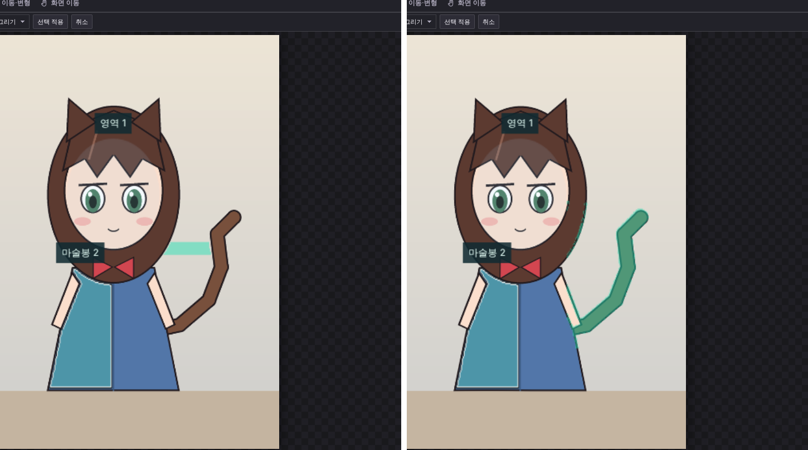

# 1-A 선택 알고리즘 (진행 중: 알고리즘 1차 완료, 새로·더하기·빼기 모드는 다음)

## 측정 도구 (`tools/select/`)
- `make_set.py`: 같은 캐릭터 구도를 화풍 5종으로 그린 테스트 세트와 부위별 정답 마스크. 결정적이라 저장소에 넣지 않고 필요할 때 다시 만든다.
  - 평면(굵은 선) · 가는 선 · 음영(그라데이션·머리카락 결·하이라이트·잡티·질감 배경) · 선 없는 그림 · JPEG 압축 손상
- `bench.js`: 브라우저 없이 `src/js/select-core.js`의 계산 함수를 직접 돌려 IoU(정답과 겹친 정도, 100%가 완벽)를 잰다. 그림 5종 × 마술봉 8곳 + 간략 범위지정 6가지.
  - 마술봉: 한 번 눌렀을 때(앱이 자동으로 고른 범위)와 범위 슬라이더 최선값.
  - 간략 범위지정: 둘러싼 직후(범위 0)와 범위 슬라이더 최선값.
  - 정답 기준: 마술봉은 '누른 덩어리'(같은 색 이웃 부위·자기 외곽선은 채점 제외). 간략 범위지정은 '올가미 안에 온전히 들어온 부위'(올가미가 가로지른 옷·팔 조각은 원하지 않은 것으로 본다. 꼬리 뿌리처럼 둘러쌀 수 없는 곳은 예외).
  - `--images`로 결과 그림(초록=맞음, 빨강=넘침, 파랑=빠짐), `--base`로 이전 결과와 나란히 비교, `--core`로 다른 버전 함수 채점.
- `core-0.5.js`: 1-A 이전 계산 함수(비교 기준).
- 계산 함수를 `src/js/select-core.js`로 분리했다(화면과 무관한 순수 함수, 앱·작업 스레드·측정 도구가 함께 씀).

## 바꾼 것
1. **간략 범위지정**: '안쪽 한 점과 바깥 테두리의 경쟁' 방식을 버렸다. 이 방식은 선화 뒤 픽셀이 양쪽에서 똑같이 막혀 동점 → 탈락했다(머리카락·꼬리 통째 실패의 원인).
   - 올가미 테두리를 따라 색이 이어지는 구간을 묶고, 긴 구간(과 같은 색)을 **배경**으로 본다. 올가미가 물체를 가로지른 짧은 구간(꼬리 뿌리·선화)은 배경에서 빠진다.
   - 배경에서 **강한 경계를 넘어야 닿는 곳 = 대상**. 선화로 둘러싸인 안쪽은 저절로 메워진다(구멍 메우기).
   - 경계 기준값은 자동: 기준값별 넓이 곡선에서 배경 잡티를 넘은 뒤 처음 평평해지는 곳.
   - 올가미가 가로지른 덩어리는 닿은 길이가 크기(√넓이)보다 길면 뺀다(옷 옆면이 썰린 조각). 짧으면 남긴다(꼬리 뿌리).
   - 범위 슬라이더·남길 곳/뺄 곳 보정은 그대로 동작한다(점수 = 배경 장벽 − 자동 기준값).
2. **마술봉**: 선화(양옆 2~3칸보다 확연히 어두운 가는 줄)에는 들어갈 수만 있고 거기서 더 퍼지지 않는다. 자기 외곽선까지만 잡고, 외곽선을 타고 온몸으로 번지지 않는다. 누른 곳이 선화면 이 규칙을 끈다.
   - 범위 슬라이더를 끝까지 올렸을 때 선화에 막혀 닿지 못한 곳까지 잡히지 않도록 상한을 막았다.
   - 자동 범위 규칙은 여러 안(가장 평평한 곳, 첫 평평한 구간, 급증 직전, 최대 비율 급증, 기준 완화)을 시험했으나 모두 원래보다 나빠 **원래 규칙 유지**.

## 결과 (0-5 → 1-A, IoU 평균)
| 항목 | 이전 | 지금 |
|---|---|---|
| 간략 범위지정, 둘러싼 직후 | **28.9%** | **88.0%** |
| 간략 범위지정, 슬라이더 최선 | 84.5% | 92.6% |
| 마술봉, 한 번 누름 | 92.4% | 94.7% |
| 마술봉, 슬라이더 최선 | 98.7% | 99.1% |
| 마술봉 계산 시간 | 377ms | 212ms |

위: 이전 / 아래: 지금. 꼬리 사각형(음영), 캐릭터 전체(가는 선), 머리 둘레(JPEG), 마술봉 앞머리(평면).

실제 앱(기준선 측정기, 꼬리를 사각형으로 대충 둘러쌈). 왼쪽 이전(가는 띠 591픽셀), 오른쪽 지금(꼬리 2,826픽셀).

## 앱 회귀 확인 (`run.js`, 0-5 → 1-A)
- 오류 0건, 저장 왕복 동일(이미지·설정), 동작 시험 5종 동일, 성능 변화 없음.
- 달라진 것은 선택 결과뿐: 간략 범위지정 591 → 2,826픽셀(꼬리), 그에 따라 선택 화면·감상 화면 스크린샷이 다르다(의도한 변화). 마술봉 5,875 → 5,874픽셀.

## 남은 약점 (다음에 다룰 것)
- 선 없는 그림에서 배경과 색이 비슷한 피부(팔·귀)를 둘렀을 때: 경계가 배경 잡티 수준이라 0%. 슬라이더 최선값도 이전보다 낮다(팔 90 → 25, 귀 100 → 52). '남길 곳' 보정으로 메울 수 있다. 근본 해결은 배경 색 모델(올가미 바깥 띠) 또는 넓게 본 경계인데, 넓게 본 경계는 시험 결과 다른 경우를 망쳐 보류.
- 마술봉 자동 범위: 음영·결이 강한 꼬리(음영 62%, 선 없음 7%). 슬라이더로는 93~99%까지 된다.
- 테스트 세트가 합성 그림뿐이다. 실제 그림(사용자 제공)으로 확인이 필요하다.

## 다음
- 청사진 요구: 선택 도구의 **새로·더하기·빼기** 모드(지금은 새로·더하기만), 마술봉의 더할/뺄 곳 지정.
