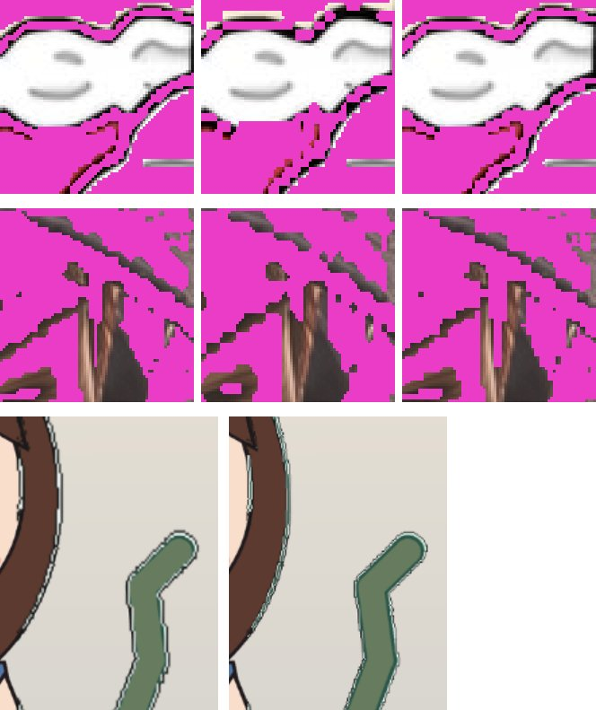

# 1-B 고해상 마스크 — 측정 (코드 변경 없음)

가설: 선택 결과를 384×384 격자로 저장해서 경계가 거칠어진다. 격자를 키우면 좋아진다.
결론부터: **384 저장으로 잃는 정확도는 작고, 격자를 키우는 비용은 크다.** 전면 고해상화는 권하지 않는다(사용자 결정 대기).

## 측정 도구
- `node tools/select/grid.js [--images]` (약 40초): 앱 흐름(긴 변 768에서 계산 → TILE×TILE 정사각으로 가장 가까운 칸 뽑기 → 그림 크기로 부드럽게 늘림)을 그대로 흉내 내 격자 384·512·768·1024를 비교. 결과 `tools/select/out/grid.json`.
  - 합성 세트: 정답 대비 IoU.
  - 실제 그림 3장(원본 크기): '768 계산 결과를 원본 크기로 바로 늘린 것'과 비교. 경계 어긋남(원본 픽셀) = 다른 픽셀 수 ÷ 경계 길이, 잃은 넓이 = 격자 저장 후 사라진 비율.
- `python3 tools/select/grid_crops.py`: 위 결과에서 384와 768이 가장 많이 다른 곳을 3배 확대(왼쪽 768 그대로 / 가운데 384 / 오른쪽 1024). `tools/select/out/grid/`.
- `node tools/select/grid_cost.js` (약 5분): 결과물의 `TILE`만 바꾼 사본으로 같은 조작(타원·마술봉 2·간략 범위지정)을 하고 시간·크기를 잰다. CPU 1배(PC)와 4배 느리게(폰 흉내). 경계 부드러움·바깥 확장은 격자에 비례해 늘려 겉모습을 맞췄다. 두 번 재서 ±5% 안.

## 결과 1: 정확도
| 격자 | 합성 IoU 평균 | 실제 그림 경계 어긋남 | 잃은 넓이 | 저장 runs |
|---|---|---|---|---|
| 768 그대로(상한) | 91.9% | 0 | 0 | — |
| **384 (지금)** | **91.8%** | **0.81 원본px** | **2.6%** | 8.7KB |
| 512 | 91.8% | 0.56px | 1.9% | 12.8KB |
| 768 | 91.9% | 0.21px | 0.7% | 20.7KB |
| 1024 | 91.9% | 0.32px | 1.1% | 28.0KB |
| 테두리 상자만 원본 해상도(REVIEW 안) | — | — | — | 37.3KB |

- 선택 정확도를 정하는 건 격자가 아니라 **알고리즘**이다. 합성 세트에서 384 저장은 IoU를 0.1%p만 깎는다.
- 실제 그림(원본 1100~1450px 높이)에서 384 저장은 경계를 평균 1픽셀 안쪽으로 옮긴다. 잃는 넓이는 대부분 **가는 부분**(머리카락 끝, 점선 외곽): 003 캐릭터 점선 외곽 9.7%, 나머지 0.5~3.4%.
- **1024는 768보다 나쁘다.** 선택 계산이 긴 변 768에서 이뤄지므로 그보다 큰 격자는 얻을 게 없다. 격자를 키운다면 상한은 768, 더 원하면 선택 계산 해상도부터 올려야 한다(계산 시간 증가).

## 결과 2: 눈에 보이는가
위: 003 캐릭터 점선 외곽, 가운데: 002 오른쪽 머리(각 왼쪽 768 그대로 / 가운데 384 / 오른쪽 1024, 원본 3배 확대, 자홍 = 선택 밖). 아래: 폰(3배 화면)에서 꼬리 선택 직후 편집 화면, 왼쪽 384 / 오른쪽 768.

- 원본을 3배 확대한 최악의 곳에서는 384 계단과 가는 선 끊김이 보인다.
- 실제 앱 화면에서는 차이가 작다. 폰 편집 화면의 가장 큰 차이는 **선택 테두리 선 굵기**(384는 한 칸이 화면 3픽셀이라 테두리가 굵다)이고, 이건 격자와 별개로 테두리 그리는 방식만 바꿔도 된다.
- 움직임 마스크는 기본 경계 부드러움 8(384에서 흐림 5칸 ≈ 원본 15픽셀)이 계단을 덮는다. 계단이 드러날 수 있는 곳은 흐림이 없거나 거의 없는 곳뿐이다: **'외곽까지 흔들기' 분리 레이어**(흐림 없음), 몸체 경계(기본 1칸), 경계 부드러움 0.

## 결과 3: 비용 (같은 기계, 소프트웨어 WebGL, 전후 비교용)
| 항목 | 384 | 768 | 1024 |
|---|---|---|---|
| 경계 부드러움 슬라이더 끄는 동안 한 프레임, PC | 61~65ms | 115ms | 172ms |
| 같은 것, **폰 흉내(CPU 4배 느림)** | **143ms** | **358~370ms** | **600ms** |
| 마술봉 적용, 폰 흉내 | 0.63초 | 0.95~1.03초 | 1.52~1.58초 |
| 되돌리기 1회, 폰 흉내 | 0.92초 | 1.34초 | 1.70초 |
| 저장 파일(영역 4개) | 104KB | 113KB | 119KB |
| 되돌리기 한 칸 | 11KB | 21KB | 27KB |
| 마스크 캔버스 메모리(계산, 영역 4개) | 18MB | 72MB | 128MB |

- **걱정했던 저장 크기·되돌리기 크기는 문제가 아니다.** runs가 경계 길이에 비례해서 격자를 2배로 해도 2배 정도. 9MB 되돌리기 상한에 한참 못 미친다. '상자만 원본 해상도 + 영역 차분 되돌리기' 같은 복잡한 저장 구조는 필요 없다.
- **문제는 반응 속도와 메모리.** 마스크 만들기(흐림·확장·자르기)가 넓이에 비례해서 768이면 슬라이더 반응이 폰에서 0.14초 → 0.36초로 느려진다. 영역 12개면 384는 약 40MB, 768은 약 170MB로 모바일에서 위험하다.

## 판단 (우선순위: 조작 난이도 > 완성도 > 경량화)
- 전면 768: 얻는 것(경계 평균 0.6픽셀, 가는 부분 2%)에 비해 잃는 것(폰 슬라이더 2.5배 느림, 메모리 4배)이 크다. **권하지 않는다.**
- 대안(필요하다고 판단될 때, 각각 작은 일):
  1. **선택 테두리 그리기만 다듬기**: 편집 화면에서 가장 눈에 띄는 차이. 격자와 무관, 비용 없음.
  2. **'외곽까지 흔들기' 영역의 분리 마스크만 768로**: 흐림이 없어 계단이 드러날 수 있는 유일한 곳. 영역 1개라 비용이 작다. 다만 실제 움직임 화면에서 보이는지 먼저 확인.
  3. 가는 부분 손실(점선 외곽 등)은 격자보다 선택 알고리즘 쪽 과제(1-A 남은 약점과 같음).

## 다음
사용자 결정: 1-B를 '측정 후 보류'로 닫고 2단계(움직임)로 갈지, 위 대안 1·2 중 하나를 먼저 할지.
