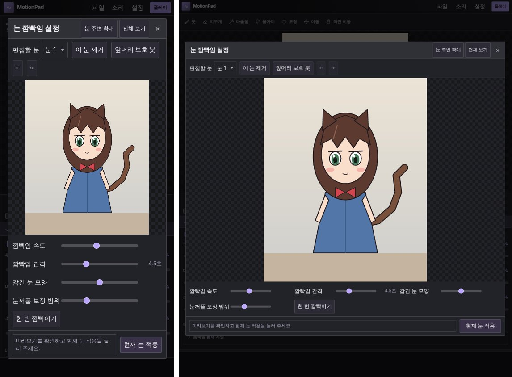

# 2-A 눈 깜빡임 간격 옵션 + 깜빡임 설정창 정렬

## 바꾼 것
- 청사진 [필수] '깜빡임 빈도': 눈 깜빡임 설정창에 **깜빡임 간격** 슬라이더(2~10초, 0.5초 단위, 기본 4.5초 = 이전과 같음). 옆에 '4.5초'처럼 값 표시.
  - 저장: 프로젝트 `extra.blink.interval`. 이전 파일은 값이 없으면 4.5초. 포맷 v2 그대로(이전 앱은 이 값을 무시).
  - 간격을 바꾸면 그 순간부터 새 주기로 센다(1초 뒤 첫 깜빡임).
- 사용자 제보: 설정창 슬라이더 줄이 어긋남(이름이 긴 '눈꺼풀 보정 범위'만 슬라이더가 아래로 떨어짐). 각 줄을 '이름 칸(고정 폭) · 슬라이더 · 값' 세 칸으로 맞췄다. 폰은 한 줄에 하나, 넓은 화면은 칸이 되는 만큼 나란히.

왼쪽 폰 390px, 오른쪽 폴드 펼침 884px.

## 확인
- 간격 7초로 바꿈 → 저장 파일에 7 → 새 창에서 열면 7초로 복원. 오류 0.
- 앱 회귀(`run.js`, 이전 커밋과 비교): 오류 0, 동작 시험 5종 동일, 성능 차이 없음. 시계 고정 스크린샷 전부 0.00%, 실시간 선택 스크린샷 0.24~0.27%(재실행 흔들림 범위).
