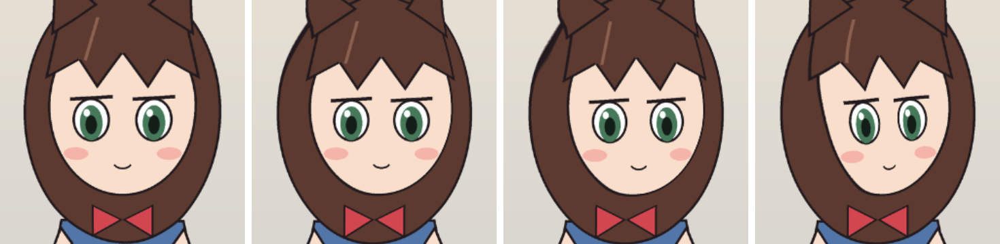

# 2-B 잡아당기는 변형 (터치)

사용자 우선순위(2026-11-13): 잡아당기는 변형 > 움직임 빈도 > 외곽까지 흔들기 다중 적용. 셋 다 순서대로 하고, 이번 단계는 잡아당김만.

## 바꾼 것
- 영역 속성 **잡아당김**(0~100%, 기본 50%). 옵션 패널 '세부 설정 (탄성·각도·크기)'의 잔진동 길이 아래.
  - 0%: 이전과 같다(끌면 영역 전체가 함께 움직임).
  - 올릴수록 **누른 지점 둘레만** 손가락을 따라 늘어나고, 멀어질수록 덜 움직인다(가우시안 분포). 놓으면 기존 스프링(반발 속도·잔진동)대로 돌아온다.
  - 누른 지점은 누르는 순간 기억해 끄는 동안 고정(`grabX/grabY`, 저장 안 하는 실행 상태).
  - 당김 변위에는 부드러운 상한(최대 약 6%)을 걸어 한계에서 찌그러지지 않게 했다.
  - 잡아당길수록 손가락을 멀리 끌 때 더 따라온다(끌기 상한 최대 2.5배).
- 셰이더 uniform `u_pull[12]` 추가(누른 지점·끌기 변위). 당김 세기는 기존 `u_chainMid`의 빈 칸 사용. 영역당 vec4 13개 × 12 = 156.
- WebGL이 없을 때의 CPU 경로(cpuDeformation)도 같은 식.
- 저장: 영역에 `pull` 키 추가(포맷 v2 그대로). 이전 파일은 50%로 열린다. 이전 앱은 이 키를 무시.

얼굴 영역을 눌러 오른쪽으로 끈 채 멈춘 화면(움직임 강도 60). 왼쪽부터 누르기 전 / 잡아당김 0% / 50% / 100%.

## 확인
- 앱 회귀(`run.js`, 2-A와 비교): 오류 0, 저장 왕복 동일(파일 +30바이트 = 영역별 pull 키), 선택 결과 동일, 동작 시험 5종 통과.
- 스크린샷: 시계 고정 장면 0.00~0.05%(잡음 기준 0.1% 이하). 실시간 선택 장면 0.26~0.93%: 차이 그림을 보니 캐릭터 윤곽 전체에 고르게 퍼진 전체 호흡 위상 차이(터치 없음 → 잡아당김과 무관).
- 성능: 플레이 FPS 24.1 → 22.6, 슬라이더 프레임 +3ms(약 6%). 재실행 흔들림 ±5% 경계. 셰이더에 영역당 지수 계산 1번이 늘었다. 폴드 60 FPS 여유 안에서 문제없을 것으로 보지만 실기기 확인 부탁.

## 다음
- 2-C 움직임 빈도(움직임 사이 쉬는 간격) → 2-D 외곽까지 흔들기 다중 적용(텍스처 슬롯 6/8 사용 중이라 설계·비용 검토부터).
