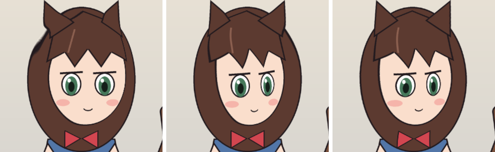

# 2-C 움직임 사이 쉬는 간격 + 극단값 튐 조사

## 바꾼 것
- 영역 속성 **움직임 사이 쉬는 간격**(0~6초, 0.5초 단위, 기본 0 = 쉬지 않음 = 이전과 같음). 옵션 패널 '자동 움직임 속도' 아래.
  - 약 2.5초(÷ 자동 움직임 속도) 움직이고 → 0.6초에 걸쳐 부드럽게 멈추고 → 지정한 초만큼 쉬고 → 부드럽게 다시 시작.
  - 대상: 그 영역의 자동 움직임 전부(자동 흔들림, 바람, 부분 호흡·물결·비틀림·흐름). 터치 반응·터치 파동은 그대로.
  - 영역마다 시작 시점이 조금씩 달라(위상) 여러 영역이 동시에 멈췄다 움직이지 않는다.
  - 저장: 영역에 `autoRest` 키(포맷 v2 그대로, 이전 파일은 0).
- 확인: 옷 영역 자동 움직임, 0.25초마다 화면 변화(# 움직임, . 멈춤).
  - 0초: `###########################################`
  - 3초: `#......#######.....#######......#######....`

## 극단값 튐 조사 (사용자 제보, 2-B)
- 재현: 움직임 강도 80·반발 속도 30·잔진동 100%·터치 배율 200%로 얼굴을 크게 끌고 멈춤.
- 왼쪽부터 잡아당김 0% / 100% / 100% + 경계 부드러움 45.

- 잡아당김 0%에서 영역 왼쪽 바깥(머리 윤곽)에 **검은 줄이 늘어지는 번짐**이 생긴다. 원인: 영역 전체가 크게 이동하는데 경계 흐림 띠는 좁아서, 띠 안에서 이동량이 급하게 바뀐다. 그러면 그림이 접히듯 뒤집혀 보이고(fold-over), 움직일 때는 반대쪽으로 튀는 것처럼 보인다.
- 잡아당김 100%는 이동이 누른 곳에 모이고 부드러운 상한이 있어 생기지 않았다. 경계 부드러움을 올려도 사라진다.
- 고치는 방법(사용자 결정 대기): 경계 흐림 폭에 맞춰 영역의 최대 이동량을 자동으로 줄인다. 대신 경계가 아주 선명한 영역(경계 부드러움 0~3)은 지금보다 덜 움직인다. 흔한 설정이 아니라 지금은 두고, 옵션 정리 단계에서 함께 정해도 된다.

## 앱 회귀 (`run.js`, 2-B와 비교)
- 오류 0, 저장 왕복 동일(파일 +39바이트 = 영역별 autoRest 키), 선택 결과 동일, 동작 시험 5종 통과, 성능 차이 없음(흔들림 범위).
- 스크린샷: 실시간 장면(play·select) 0.07~0.35%, 재실행 흔들림 범위(0.7% 이하).
