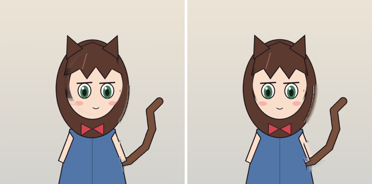

# 2-D 외곽까지 흔들기 여러 영역 (최대 4개)

## 바꾼 것
- '외곽까지 흔들기'를 영역 **4개까지** 동시에 켤 수 있다(이전 1개). 5개째를 켜면 안내 문구.
- 그래픽 칸(텍스처 슬롯)은 늘리지 않았다(6/8 그대로).
  - 영역 모양: 텍스처 한 장의 R·G·B·A 채널에 영역 하나씩.
  - 빈자리 배경판: 켜진 영역을 모두 합친 모양으로 한 장. 인접한 영역의 빈자리도 한 번에 메운다.
  - 원본 그림: 모두 같은 그림을 함께 쓴다.
- 겹치는 부분은 영역 목록 순서대로 위에 그린다(뒤 영역이 위).
- 셰이더 `u_tailCutout`: float → vec4(켜진 영역 번호 4개). WebGL이 없을 때의 캔버스 경로도 영역마다 따로 그린다.
- 저장 형식 변화 없음(영역의 `tailCutout` 키 그대로). 이전 앱에서 열면 첫 영역만 적용된다.

얼굴(타원)과 꼬리 둘 다 켜고, 왼쪽 얼굴을 끈 모습 / 오른쪽 꼬리를 끈 모습.

## 확인
- 오류 0(셰이더 컴파일 포함). 두 영역이 각자 움직이고 빈자리가 메워짐.
