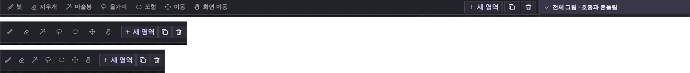

# 2-E 도구줄 영역 관리 + 확인창 (영역 창 1차)

사용자 설계(2026-11-13): 영역 생성·복제·삭제는 캔버스 작업이므로 도구줄에서 한다. '새 영역'은 가장 중요해 글자로, 복제·삭제는 아이콘. 자리가 모자라면 도구를 아이콘으로(포토샵 도구상자처럼). 모바일 터치 실수 대비로 작업이 날아갈 수 있는 버튼은 모두 확인창, 문구는 상황별.

## 바꾼 것
- 도구줄: 도구 | 구분선 | **[+ 새 영역] [복제 아이콘] [삭제 아이콘]**(삭제가 맨 오른쪽). 아래 되돌리기 줄의 '새 영역' 버튼은 옮김(같은 id).
- 좁은 폰(520px 이하): 도구는 아이콘만, '새 영역'은 글자 유지. 폰 390px·폴드 겉화면 344px에서 넘침 없음.
- 공용 확인창(`askConfirm`, 앱 디자인, 취소가 기본 초점). 넣은 곳과 문구:
  - 영역 삭제(도구줄·패널·영역 메뉴): "‘이름’ 영역과 그 움직임 설정을 지울까요? 실행 취소로 되돌릴 수 있습니다." [영역 삭제]
  - 새 그림 열기·프로젝트 열기(파일로 저장하지 않은 변경이 있을 때만): "…새 그림을 열면 지금 작업은 사라집니다. 그래도 열까요?" [저장하지 않고 열기]
  - 시작 화면 새 그림·프로젝트·샘플(자동 저장된 이전 작업이 있을 때만): "…새로 시작하면 이전 작업은 이어할 수 없게 됩니다." [새로 시작]/[샘플 열기]
  - 눈 깜빡임 '이 눈 제거', '추가 축 삭제'.
- '저장하지 않은 변경' = 마지막 파일 저장·열기·새 그림 때와 영역·설정이 다름.
- 사용자 결정: '편집 중' 표시는 넣지 않음(영역선이 기본으로 켜져 선택 영역을 보여 줌).

## 확인
- 삭제 확인 → 취소하면 그대로, 확인하면 삭제. 복제 동작. 새 그림 열기: 저장 전 확인창, 저장 후 확인창 없음. 오류 0.
- 도형 시험 11단계·선택 방식 시험 9단계 통과.

## 남은 것 (움직임 옵션 정리 단계)
- PC 세로 영역 목록(접기·펴기, 효과 아이콘), 폰 영역 목록 실선 묶음 디자인.
- 폰에서 아이콘만 남은 도구는 이름이 안 보인다 → 3단계 하단 안내줄에서 '붓이 선택되었습니다' 식으로 안내.
