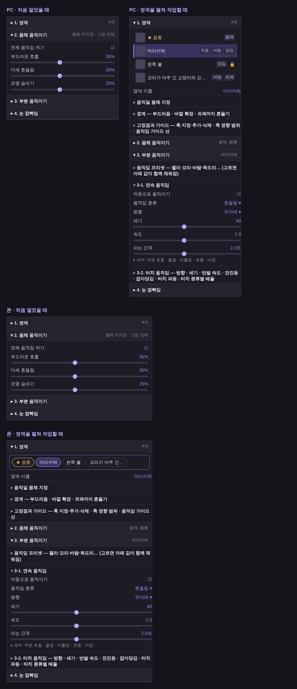

# 2-F 움직임 옵션 정리 + 영역 목록 — 구조 확정, 구현 대기



#### 확정 구조 (2026-11-13 사용자 확정, 시안 2차)
처음 열 때: 1 접힘, 2 펼침, 3·4 접힘. 모든 하위 묶음은 처음엔 접힘.
```
▸ 1. 영역  [제목 옆: 영역 수]
     영역 목록 (PC 세로·효과 이름표·잠금 / 폰 가로 이름표, 실선 묶음은 3단계)
     영역 이름
     ▸ 움직일 몸체 지정 (지정·배경 제외·자동 크롭·몸체 경계 흐림)
     ▸ 경계 (경계 부드러움 · 경계 바깥 확장 · 외곽까지 흔들기)
     ▸ 고정점과 가이드 (축 지정·추가·추가 축 삭제 · 선택 축 활성화 · 축 영향 범위 · 움직임 가이드 선 · 가지 선 삭제)
▾ 2. 몸체 움직이기  [제목 옆: '몸체 미지정 · 그림 전체' 또는 '몸체: {이름}']  (지금 '전체 그림' 옵션: 켜기·호흡·흔들림·조명)
▸ 3. 부분 움직이기  [제목 옆: 선택한 영역 이름]
     ▸ 움직임 프리셋 (지금 '움직임 종류' 목록. 고르면 3-1·3-2 값이 함께 채워짐)
     ▸ 3-1. 연속 움직임: 자동으로 움직이기 · 움직임 종류·방향·세기·속도(지금 빠른 설정) · 쉬는 간격 · ▸세부(부분 호흡·물결·비틀림·흐름+방향·바람 5개)
     ▸ 3-2. 터치 움직임: 방향 · 반응 세기 · 반발 속도 · 잔진동 길이 · 잡아당김 · 터치 파동 · ▸터치 종류별 배율(짧게·드래그·길게·튕김)
▸ 4. 눈 깜빡임
```
- 영역을 고르지 않았을 때 3-1·3-2 안: "먼저 영역을 만들거나 선택해 주세요." 한 줄.
- 잡아당김(누른 곳 중심)과 축(고정한 곳 중심)은 각 묶음 첫 줄 설명으로 구분.
- 구현 때 확인: 지금 빠른 설정(방향·세기·속도)은 프리셋에 따라 연결된 값이 다르다(controls.js quick*). 3-1로 옮기며 '자동 움직임의 세기·속도'로 뜻을 고정할지 검토.

 없애는 것
- 타원 너비·높이·각도 슬라이더: 도형 도구 손잡이·두 손가락(1-A 5차)과 중복.
- 패널의 복제·삭제 버튼 2쌍: 도구줄과 중복.

## 겹치는 기능 정리 (설명 문구로 구분)
- 잡아당김 = '누른 곳'이 가장 많이 움직임. 축 = '고정한 곳'은 안 움직이고 멀수록 많이. 각 묶음 첫 줄에 한 줄 설명.
- 빠른 설정의 세기·속도는 움직임 종류에 따라 아래 세부 값을 함께 바꾸는 손잡이(지금 동작 유지). 세부 묶음 안 같은 값과 이름이 겹치지 않게 '반응 세기' 등으로 구분.

## 함께 할 것
- 극단값 튐(2-C): 경계 부드러움에 맞춰 최대 이동량 자동 제한(선명한 영역은 덜 움직임) — 경계 묶음에 넣고 사용자 판단.
- 저장 형식 불변(속성 키는 그대로, 이름·위치만 바뀜).
