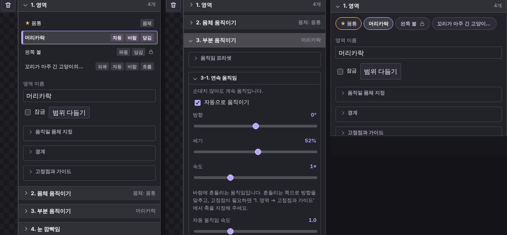

# 2-F 움직임 옵션 정리 + 영역 목록 (구현)

구조는 `2-F-plan.md`(사용자 확정 시안 2차) 그대로. 저장 형식 불변(속성 키 그대로, 이름·위치만 바뀜).

## 바꾼 것
- 옵션 패널을 네 묶음으로: **1. 영역**(처음 접힘) · **2. 몸체 움직이기**(처음 펼침) · **3. 부분 움직이기**(접힘) · **4. 눈 깜빡임**(창 열기). 하위 묶음은 모두 처음엔 접힘.
- 머리줄 오른쪽 정보: 1 = 영역 수, 2 = '몸체 미지정 · 그림 전체' 또는 '몸체: 이름', 3 = 선택한 영역 이름.
- **영역 목록**
  - PC: 세로 목록. 이름 + 켜진 효과 이름표(몸체·외곽·자동·바람·흐름·호흡·물결·비틀림·파동·당김 순) + 잠금 아이콘. 칸이 좁으면 뒤쪽 이름표부터 숨는다. 마우스를 올리면 수치가 보인다.
  - 폰: 가로 이름표(몸체는 별표·노란 테두리, 잠금 아이콘). 실선 묶음 디자인은 3단계.
  - 호흡 이름표는 기본값(8) 이하면 표시하지 않음(모든 영역에 기본으로 있어 소음이 됨).
  - 길게 누름·우클릭 영역 메뉴는 그대로.
- 1. 영역 안: 영역 이름, 잠금·범위 다듬기, ▸움직일 몸체 지정(지금의 몸체 설정 그대로 옮김, '베이스' → '몸체'로 말 통일), ▸경계(경계 부드러움·경계 바깥 확장·외곽까지 흔들기), ▸고정점과 가이드(축 지정·축 추가·움직임 가이드 선 · 선택 축 활성화 · 축 영향 범위 · 추가 축 삭제).
- 3. 부분 움직이기 안: ▸움직임 프리셋 · ▸3-1 연속 움직임(자동으로 움직이기·방향·세기·속도·쉬는 간격·▸세부: 부분 호흡·물결·비틀림·흐름+방향·바람 5개) · ▸3-2 터치 움직임(방향·반응 세기·반발 속도·잔진동 길이·잡아당김·터치 파동·▸터치 종류별 배율).
- 잡아당김과 축은 각 묶음 첫 줄 설명으로 구분: 축 = "고정한 곳은 움직이지 않고 멀수록 많이", 잡아당김 = "누른 곳이 가장 많이".
- 영역을 고르지 않았을 때 3 안: "먼저 영역을 만들거나 선택해 주세요."
- 없앤 것: 타원 너비·높이·각도 슬라이더(도형 도구 손잡이·두 손가락과 중복), 패널의 복제·삭제 버튼 2쌍(도구줄과 중복), 숨어 있던 '선택 영역 반응' 버튼, 폰에서 2·3 묶음을 서로 닫던 동작(시안대로 1·3을 함께 펼칠 수 있게).

## 검토 항목의 결정 (plan의 '구현 때 확인')
- 3-1의 **세기·속도는 '자동 움직임의 것'으로 뜻을 고정**했다.
  - 바람 계열(꼬리·긴 머리·목도리): 방향=바람 방향, 세기=바람 강도, 속도=바람 속도(전과 같음).
  - 부분 호흡: 세기=호흡, 속도=호흡 속도(전과 같음). 흐름: 방향·세기(전과 같음).
  - 직접 설정·부드러운 반응·젤리: 전에는 속도가 '반발 속도'(터치 값)였다 → **'자동 움직임 속도'로 바꿈**. 반발 속도는 3-2에만 있다. 이 종류의 자동 움직임은 터치 반응을 스스로 되풀이하므로 세기는 3-2 '반응 세기'와 같은 값이고, 안내 문구로 알린다.
  - 3-1 속도가 자동 움직임 속도일 때는 따로 있던 '자동 움직임 속도' 줄을 숨긴다(중복 방지).
- 극단값 튐 자동 제한(plan '함께 할 것'): 2-M 거리 기반 접힘 방지로 이미 해결돼 넣지 않았다.

## 확인
- `schema_check.js`(2-M 끝 결과물과 비교): 불러온 뒤 저장 같음, 오류 0. 차이는 지운 타원 슬라이더 3개(화면 표시)와 그 슬라이더로 바뀌던 rx·ry·rot뿐(의도).
- 검증 도구는 새 묶음 id(zonesPanel·edgePanel·presetPanel·autoPanel·gainPanel)도 펼치도록 고쳤다. 없는 입력은 건너뛴다.
- 앱 회귀·선택 방식·도형 시험 결과는 아래.
