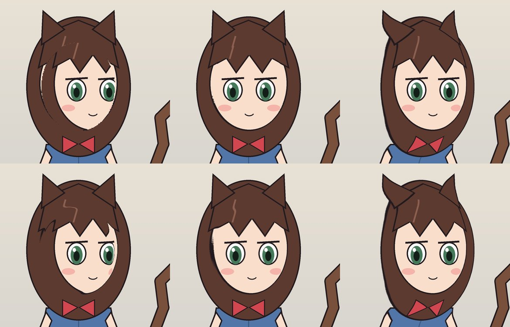

# 2-M 움직임 품질 측정: 빈자리 메우기 + 극단값 튐 (코드 변경 없음, 결정 대기)

앱 소스(`src/`)는 건드리지 않았다. 측정 도구와 후보 알고리즘만 `tools/motion/`에 있다. 2-F(옵션 정리) 구현 전 단계.

## 1. 빈자리 메우기

### 재는 법
- 정답을 아는 시험 18개: 그림 위에 외곽선 있는 물체(꼬리·머리 모양)를 붙이고, 붙이기 전 배경을 정답으로 삼는다. 기준선 캐릭터 꼬리 + 실제 그림 3장(`samples/`)의 8곳, 각각 꼭 맞는 선택(tight)과 1칸 모자란 선택(loose).
- 마스크는 앱과 같게 만든다(384 격자 → 2칸 넓힘 → 긴 변 850 작업 크기).
- **화면에 드러나는 띠만** 채점한다. 분리 영역은 그림 크기의 5.5%까지만 움직이므로 빈자리 깊숙한 곳은 영영 안 보인다. near = 가장자리 0~2%, far = 2~5.5%.
- 수치는 정답과의 색 차이 평균(0~255, 작을수록 좋음). 시간은 PC의 node 기준(폰은 대략 3~4배).

### 후보
| 방식 | 하는 일 |
|---|---|
| 지금 | 가로줄·세로줄마다 양 끝 색을 이어 붙임(`buildBackgroundPlate`) |
| 부드럽게 | 사방의 색이 고르게 스며들게 함(pull-push + 완화) |
| 조각 붙이기 | PatchMatch. 둘레와 닮은 조각을 그림의 다른 곳에서 찾아 붙임. '부드럽게'의 결과를 길잡이로 삼아 엉뚱한 색을 막음 |
| 조각 붙이기(가벼움) | 같은 방식을 절반 크기에서 계산하고 반복을 줄임 |

### 결과 (18개 평균)
| 방식 | near | far | 시간(빈자리 3%) | 시간(빈자리 30%) |
|---|---|---|---|---|
| 지금 | 14.8 | 19.1 | 10ms | 37ms |
| 부드럽게 | 14.5 | 17.9 | 18ms | 41ms |
| 조각 붙이기 | **13.0** | **16.9** | 840ms | 7.6초(띠만 계산하면 3.4초) |
| 조각 붙이기(가벼움) | 14.6 | 17.1 | 140ms | 1.2초(띠만 계산하면 0.6초) |

물체를 오른쪽으로 5.5% 옮긴 실제 모습. 왼쪽부터 정답 / 지금 / 부드럽게 / 조각 붙이기 / 조각 붙이기(가벼움).


### 읽는 법
- **지금 방식의 한계는 줄무늬다.** 줄마다 양 끝 색이 달라 격자 모양 자국이 생긴다. 평균 오차보다 눈에 훨씬 거슬린다(수치 차이는 작은데 그림 차이는 큼).
- '부드럽게'는 줄무늬를 없애지만 무늬 있는 배경에서는 뿌연 얼룩이 남는다. 거의 공짜다.
- '조각 붙이기'는 무늬 있는 배경(옷감, 반짝이)에서 거의 티가 안 난다. 길잡이 없이 돌리면 하늘 자리에 문어 무늬를 가져오는 실수를 했고(near 18.9), 길잡이를 넣어 해결했다.
- **어떤 방식도 못 하는 것**: 굵은 선화가 빈자리를 가로지르는 경우(접시 테두리 등). 선이 어디로 이어지는지 알 방법이 없다. 조각 붙이기는 그럴듯하지만 틀린 모양을, 부드럽게는 뿌연 얼룩을 만든다.
- 민무늬 배경은 셋 다 같다(지금 방식의 '민무늬면 평균색' 지름길이 이미 있음).

### 따로 발견한 것: 가만히 있을 때의 테두리
- 빈자리는 선택보다 2칸 넓게 파는데, 위에 얹는 그림은 선택 모양 그대로다. 그 사이 2칸 테두리는 **가만히 있어도** 메운 색이 보인다.
- 선택이 외곽선보다 1칸 모자라면 물체의 외곽선이 이 테두리에 걸려 지워진다(원본과의 차이 66, 꼭 맞을 때 15). 메우는 방식과 무관하다.
- 해법 후보: 얹는 그림도 2칸 넓힌 모양으로. 가만히 있을 때 원본과 완전히 같아진다. 대신 움직일 때 배경 2칸이 물체에 묻어 따라온다.

## 2. 극단값 튐 (접힘)

### 원인을 수치로
화면의 한 칸은 원본의 `자기 위치 − 이동량 × 마스크`를 가져온다. 경계 띠에서 `이동량 > 띠의 폭`이면 가져오는 순서가 뒤집힌다. 뒤쪽 가장자리(끌려가는 반대편)에서만 생긴다.
- 경계 부드러움 0: 이동량 0.26%부터 접힘. 3: 약 1.3%부터. 접히지 않으려면 13 이상이어야 최대 이동(5.5%)을 버틴다.

### 후보 비교 (`tools/motion/fold/sim.py`, 얼굴 타원을 오른쪽으로)
| 경계 부드러움 | 이동량 | 방식 | 접힌 칸 | 영역 안쪽 이동 |
|---|---|---|---|---|
| 0 | 5.5% | 지금 | 0.136% | 100% |
| 0 | 5.5% | 이동량 제한(2-C의 안) | 0 | **4.7%** |
| 0 | 5.5% | 거리 기반 | **0** | **100%** |
| 3 | 5.5% | 지금 | 0.552% | 100% |
| 3 | 5.5% | 이동량 제한 | 0 | 23.6% |
| 3 | 5.5% | 거리 기반 | **0** | **100%** |

위 줄 경계 부드러움 0, 아래 줄 3. 왼쪽부터 지금 / 이동량 제한 / 거리 기반.


### 거리 기반이란
- 영역마다 '가장자리까지의 거리'를 미리 한 번 계산해 둔다. 크게 움직이는 순간에만, 영역 **바깥쪽으로** 이동량의 2배 폭만큼 움직임이 서서히 줄어드는 띠를 만든다.
- 영역 안쪽은 언제나 100% 움직인다. 접히는 대신 둘레가 늘어난다(경계 부드러움을 45로 올렸을 때와 같은 모습이 필요한 순간에만 자동으로).
- 작은 움직임(지금도 접히지 않는 범위)은 지금과 완전히 같다.
- 대가: 크게 끌 때 영역 둘레(최대 그림의 11%)가 함께 딸려 온다. 그림처럼 머리 전체가 기울어 보인다. 폭 배수(2배)를 1.5배까지 줄일 수 있다.
- 비용: 텍스처 칸 1개 추가(6 → 7, 보장 8), 셰이더 영역 반복에 조건부 조회 1번(크게 움직이는 선명한 영역에서만), 영역 모양이 바뀔 때 거리 계산(384² 한 번, 수 ms). WebGL 없는 CPU 경로에도 같은 식 필요.

## 도구
```bash
python3 tools/motion/fill/make_cases.py                 # 시험 세트(약 10초)
node tools/motion/fill/run.js current smooth patch      # 표 + 결과 (--once: 시간 한 번만)
python3 tools/motion/fill/sheet.py [방식...]             # 메운 배경만 비교
python3 tools/motion/fill/moved.py [방식...]             # 물체를 옮긴 실제 모습 비교
node tools/motion/fill/big.js                           # 큰 빈자리 시간
python3 tools/motion/fold/sim.py                        # 접힘 모의 실험
```
후보 알고리즘은 `tools/motion/fill/algos.js`(캔버스 없는 순수 JS라 앱에 그대로 옮길 수 있다).

## 결정 대기
1. 빈자리 메우기를 어디까지 바꿀지(부드럽게만 / 조각 붙이기까지).
2. 극단값 튐을 거리 기반으로 고칠지, 둘레가 딸려 오는 폭.
3. 가만히 있을 때 테두리 2칸 처리.
