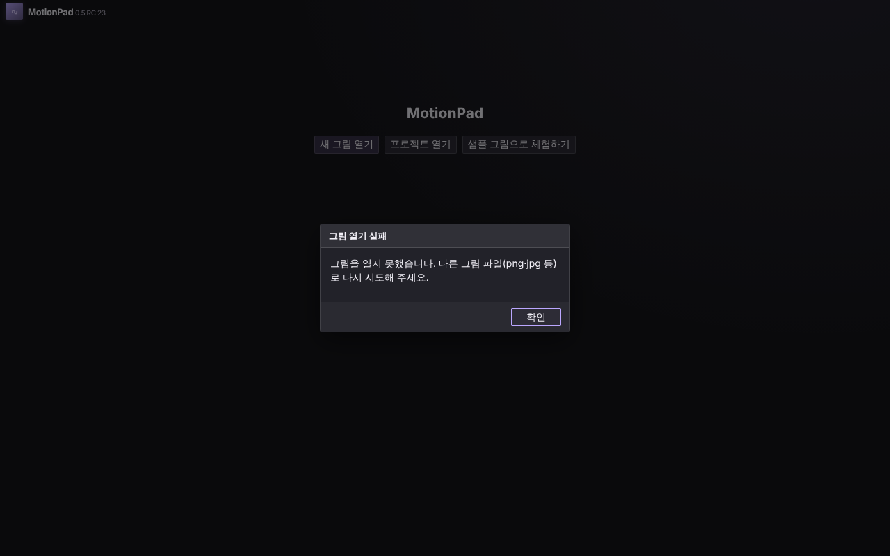

# 3-A 기본 대화창 제거

브라우저 기본 알림창(alert)·확인창(confirm)을 모두 앱 디자인 창으로 바꿨다(prompt는 0-2에서 이미 제거).

- 새 `showNotice(제목, 문구)`: 버튼 하나짜리 알림창(확인창과 같은 틀, 취소 버튼 숨김). 다른 창이 이미 떠 있으면 상태줄에 문구만 띄운다.
- 바꾼 곳 15곳: 음악 파일 선택(2), 이어하기 실패, 그림 열기 실패, 파일 저장·프로젝트 열기 실패, 기기 보관 프로젝트 저장·열기·삭제(열기·삭제 확인은 askConfirm, 문구는 상황별), 영상 내보내기(4).
- 실패 원인 문구는 있을 때만 괄호로 붙인다(`why(e)`). 원인이 없을 때 '(undefined)'가 보이던 것을 막음.
- 문구는 무엇을 하면 되는지 함께 알리도록 다듬었다(예: "다른 그림 파일(png·jpg 등)로 다시 시도해 주세요").

## 확인
- 잘못된 그림 파일 열기 → 앱 알림창, 브라우저 기본창 0, 오류 0. 이어서 영역 삭제 확인창은 취소 버튼·경고색이 그대로 돌아옴.
- `grep`으로 alert(·confirm(·prompt( 호출 0개.
