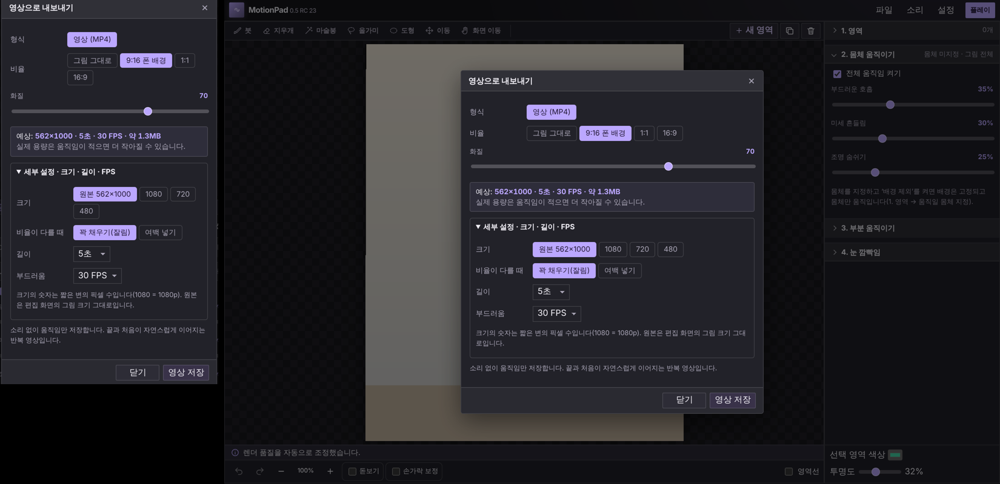

# 3-D 영상 내보내기 옵션

사용자 결정(2026-11-13): 간단히 + 세부 접기. 시안은 기능·배치만 본 것(디자인은 앱 스타일). '원본급' 같은 애매한 단계 대신 **화질 0~100 수치 + 예상 용량**. 터치 녹화·터치 이펙트는 나중에 함께.

(왼쪽 폰, 오른쪽 PC. 시안: `img/3d-video-mock.png`)

## 바꾼 것
- 창 구성: 형식 · 비율(그림 그대로 / 9:16 폰 배경 / 1:1 / 16:9) · 화질(0~100) · **예상 크기·용량** · ▸세부 설정(크기: 원본·1080·720·480 / 비율이 다를 때: 꽉 채우기(잘림)·여백 넣기 / 길이 3~15초 / 24·30·60 FPS).
- 기본값: 그림 그대로 · 원본 크기 · 화질 70 · 5초 · 30 FPS. 바로 '영상 저장'만 눌러도 된다.
- **고른 크기로 녹화**: 전에는 화면에 보이는 캔버스 크기 그대로 찍혀 폰에서 360px 안팎으로 작게 나왔다. 이제 녹화하는 동안 그림을 고른 크기로 따로 그린다(`exportRender`, 녹화가 끝나면 원래대로). PC·폰 모두 같은 크기로 나오는 것 확인(480 → 480×854).
- 크기 숫자 = 짧은 변(1080 = 1080p). 긴 변은 3840 이하. 원본 = 편집 화면의 그림 크기.
- 화질 → 비트레이트: 픽셀당 0.02~0.3비트(지수), 25만~4천만 bps. 예상 용량 = 비트레이트 × 길이. 움직임이 적으면 실제는 더 작다(5초 480×854 화질 70 → 약 70KB).
- 여백 색은 검정. 형식 이름은 브라우저가 지원하는 것(MP4, 없으면 WebM)을 표시. 파일 이름에 크기 포함(`이름_480x854_3s.mp4`).

## 한계(기록)
- '원본'은 편집 해상도다. 그림을 열 때 긴 변 1900px로 줄여 쓰므로(예전부터) 그보다 큰 그림은 영상도 최대 1900px. 프로젝트 파일에는 원본 그림이 그대로 저장된다. 더 큰 영상이 필요하면 녹화 때만 원본 그림을 올리는 방식을 따로 검토.
- 녹화는 실제 시간으로 진행된다. 보급형 폰에서 큰 크기·60 FPS는 프레임이 빠질 수 있다.
