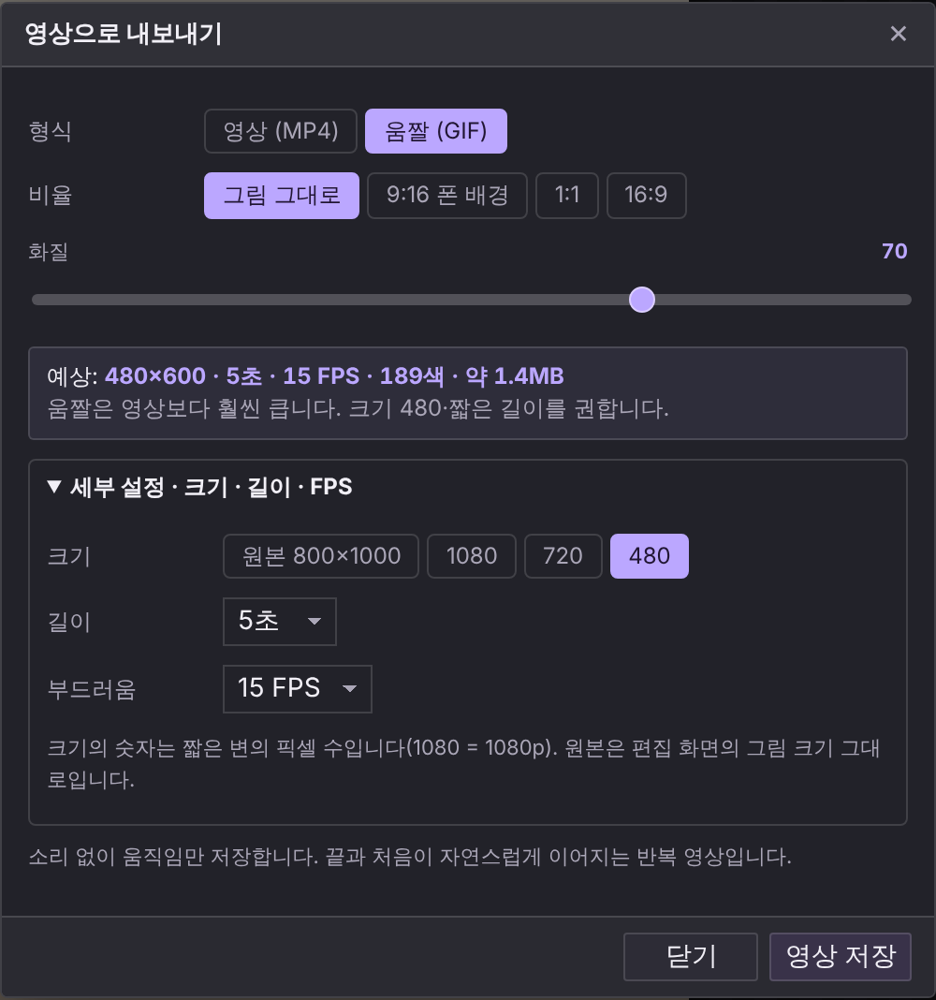

# 3-E 움짤(GIF) 내보내기

- 영상 내보내기 창의 형식에 **움짤 (GIF)** 추가. 비율·크기·화질·길이·FPS는 영상과 같은 칸을 쓴다.
- 움짤을 고르면 크기 480·15 FPS로 바꿔 둔다(영상으로 돌아가면 원본·30 FPS). 버튼 이름도 '움짤 저장'으로.
- 인코더는 직접 만들었다(`src/js/gif.js`, 외부 라이브러리 없음, 약 4KB).
  - 팔레트: 첫 프레임에서 중간 자르기로 한 번. 화질 0~100 → 색 32~256개.
  - 4×4 순서 디더링: 배경 그라데이션의 줄무늬를 없앤다. 자리마다 같은 무늬라 가만히 있는 곳은 프레임 사이에 그대로.
  - 프레임마다 앞 프레임과 달라진 사각형만 저장, 무한 반복.
  - 프레임마다 실제로 흐른 시간을 보여줄 시간으로 기록 → 기기가 느려 프레임이 빠져도 재생 속도는 맞다.
- 영상·움짤 공통: 전체 움직임(호흡·흔들림)이 그림을 밀 때 가장자리에 드러나던 검은 줄을, 흔들림 크기만큼 살짝 확대해 가린다(편집 화면은 그대로).
- 예상 용량은 대략치(움직임 양에 따라 크게 달라짐). 움짤은 영상보다 훨씬 커서 안내 문구를 붙였다.

## 확인
- 480·30 FPS·3초, 720·24 FPS·3초 움짤: Python(PIL)으로 열어 크기·프레임 수 확인, 전체 재생 시간 3.07초·3.04초(맞음), 화면 오류 0. 디더링 후 그라데이션 줄무늬 사라짐(용량은 약 1.6배).
- 헤드리스(소프트웨어 그래픽)에서는 프레임이 많이 빠진다(480에서 90장 중 36장). 실기기에서 다시 볼 것.
- 영상(MP4): 480 → 480×854(9:16), PC·폰 같은 크기.
