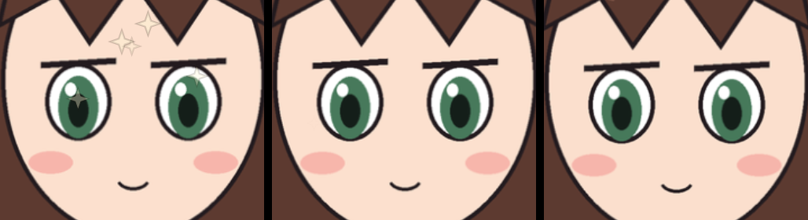

# 3-F 플레이 화면 터치 이펙트 + 녹화(●)

사용자 결정(2026-11-13): 이펙트는 시안 4개 중 **C 반짝임**(`img/3f-touchfx-mock.png`), 녹화 버튼은 **돌아가기 아이콘 옆**.

## 바꾼 것
- 플레이 화면에서 누르면 작은 별빛 5개가 톡 튀어 0.7초 만에 사라진다. 끌면 지나간 자리에 0.07초마다 2개씩. 밝은 그림에서도 보이게 얇은 어두운 테두리. 편집 화면(터치 미리보기)에는 나오지 않는다.
  - 별 크기·거리는 화면 긴 변의 1% 기준. 위치는 그림 기준이라 화면·영상 크기가 달라도 같은 자리.
  - 그리는 곳은 그림 위 전용 투명 캔버스(`#fxLayer`, 누름은 통과). `src/js/touchfx.js`.
- 플레이 화면 오른쪽 위, 돌아가기 왼쪽에 **녹화 버튼(●)**. 누르면 녹화 시작(버튼이 붉어지고 0:00 시간 표시), 다시 누르면 멈추고 저장. 최대 60초, 돌아가기·Esc로 나가도 저장된다. 저장되면 화면 아래에 "영상을 저장했습니다 · 6초 · 156KB" 안내.
  - 형식·비율·크기·화질은 '영상으로 내보내기' 창의 값을 쓴다(영상·움짤 모두). 버튼과 음악 플레이어는 영상에 찍히지 않는다.
  - 내보내기 창에 **'플레이 화면 녹화(●)에 터치 이펙트 넣기'** 체크(기본 켬). 끄면 그림의 변화만 녹화.
  - 반복 영상용 '끝을 처음과 이어붙이기'는 플레이 녹화에서는 하지 않는다.
- 움짤에 이펙트를 넣을 때는 이펙트 색 3개를 팔레트에 미리 넣는다(첫 장에 없던 색이라 다른 색으로 바뀌던 문제).

## 함께 고친 것 (3-D에서 생긴 문제)
- 녹화 크기로 캔버스를 바꾸면 그림이 한 번 지워지는데, 바로 첫 장을 찍어 **첫 장이 비어 있었다**. 그래서 움짤은 피부색이 베이지로 바뀌고(팔레트를 첫 장에서 만듦), 영상은 끝에서 빈 첫 장으로 섞였다. 다시 그려질 때까지 3프레임 기다린 뒤 찍는다.

## 확인
- 플레이 화면 녹화: 움짤(6초, 1.7MB)·영상 MP4(10초, 156KB) 저장, 버튼 원상 복귀, 화면 오류 0, 브라우저 기본창 0.
- 움짤 프레임에서 이펙트 색 확인(811픽셀), 피부색 (250,222,204) → (252,220,204)로 원본과 같음.
