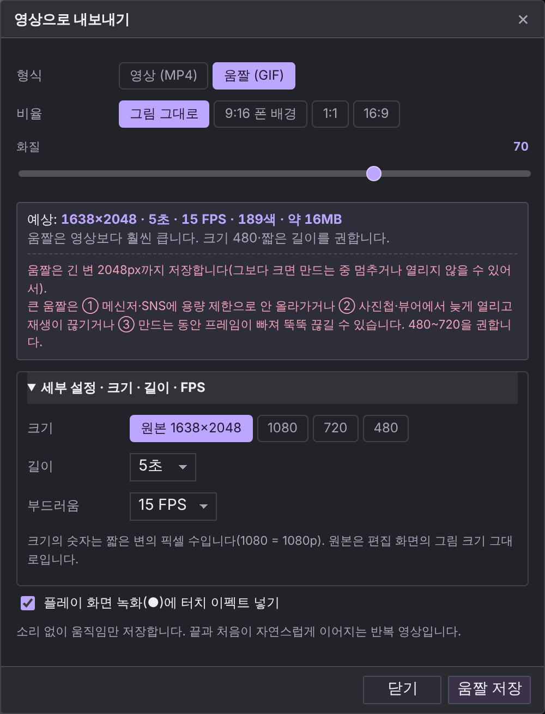

# 3-G 원본 해상도 내보내기 — 구현됨, 마무리 확인 남음 (이관 메모 포함)

사용자 결정(2026-11-13): 기기 한계 안에서 원본 채택. 상한에 걸릴 때만 안내. 움짤을 크게 고르면 용량 외 품질 문제(앱에서 안 열림·재생 끊김 등)도 경고.

## 한 것 (커밋됨)
- `src/js/export-hires.js`: 녹화하는 동안만 원본 그림을 그래픽 카드에 올리고(`enterHiRes`), 끝나면 1900 사본으로 되돌린다(`leaveHiRes` → `syncBaseTexturesGL`).
  - 채움판(외곽 흔들기용 `tailPlate`, 배경 제외용 `backgroundPlate`/`tailBasePlate`)은 1900 사본에서 만든 것이라, 사본과 다른 곳(=메운 자리)만 가림막으로 뽑아 원본 위에 덮는다(`hiPlate`). 그래서 몸체·배경·흔들리는 부위(꼬리 등, `u_tailOriginal`)는 원본 화질, 잠깐 드러나는 채움 자리만 1900.
  - 필요 없으면(고른 크기가 사본 이하, WebGL 없음) 아무것도 안 한다.
- `video.js` `videoPlan`: 원본 = 처음 연 그림 크기(`sourceSize`, `useBlob`에서 기록). 영상은 긴 변 3840 **그리고 픽셀 수 3840×2160(약 830만) 이하**, 움짤은 긴 변 2048 이하.
  - 측정: 3072×3840(1180만 픽셀)은 녹화기(MediaRecorder) 오류로 실패 → 픽셀 수 제한 추가. 3200×4000 그림 → 2576×3220으로 저장 성공.
- 안내(`videoWarnings`, 해당할 때만): 4K로 줄임 / 기기가 그릴 수 있는 최대 크기(`MAX_TEXTURE_SIZE`·`MAX_VIEWPORT_DIMS`·`MAX_RENDERBUFFER_SIZE`)에 걸림 / 큰 움짤(긴 변 1080 초과 또는 15MB 초과)은 메신저 용량 제한·뷰어 재생 끊김·만드는 중 프레임 빠짐.
- 녹화기 오류 문구를 "크기를 1080으로 줄여 다시 시도해 주세요"로.

## 확인한 것
- 2400×3000 그림(몸체+배경 제외+외곽 흔들기): 원본 2400×3000 영상 저장 성공(56KB, 헤드리스). 오류 0.
- 3200×4000 그림(영역 없음): 2576×3220 저장 성공.
- 헤드리스(소프트웨어 그래픽)는 2400px에서 초당 1프레임 남짓이라 매우 느리고, 한 번은 "파일 생성 실패"(프레임이 거의 안 찍힘)가 났다가 다시 하면 성공. 실기기에서 확인 필요.

## 남은 일 (다음 세션)
1. **원본 준비 중 멈춤 안내**: 원본 불러오기+채움판 합성(`hiPlate`, 1900 크기 getImageData 두 번)이 헤드리스에서 약 6초 동안 화면을 멈춘다. 저장 버튼을 누르면 먼저 "원본을 준비하고 있습니다" 문구를 띄우고 한 프레임 쉰 뒤 시작할 것. 가능하면 `plateHoleMask`를 녹화 전에 미리(채움판이 바뀔 때) 만들어 두기.
2. **선명도 비교 기록**: 3200×4000 고운 줄무늬 그림(`PIL`로 만든 시험 그림: 바닥·얼굴에 4px 간격 1px 줄)으로 예전 결과물(1520×1900)과 새 결과물(2576×3220) 프레임을 비교해 이 문서에 그림으로 남기기. mp4 프레임은 Chromium `<video>`에 올려 캔버스로 뽑으면 된다(ffmpeg 없음).
3. 플레이 화면 녹화(●)도 원본 경로를 탄다(같은 `recordVideo`). 위 2에서 함께 확인.
4. 회귀: `run.js`(3-F 결과물과 비교)·`selop_check`·`shape_check`, `build.js --check`.
5. 끝나면 `docs/progress/README.md` 표(3단계 줄)와 `CLAUDE.md` 현재 위치에 3-G 반영. 3단계 남은 일: 폰 영역 목록 실선 묶음 디자인, 선택 테두리 다듬기(1-B에서 미룸), 실기기 확인.
