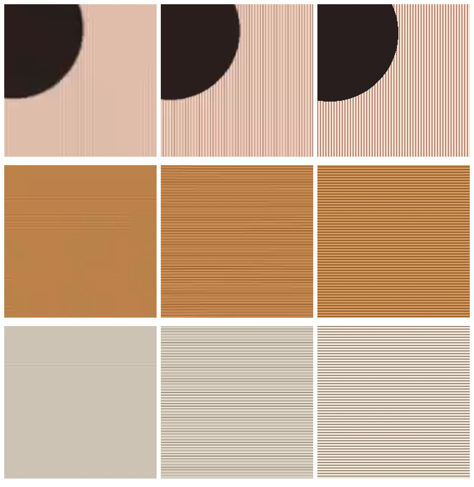

# 3-G 원본 해상도 내보내기 — 완료 (실기기 확인 대기)

사용자 결정(2026-11-13): 기기 한계 안에서 원본 채택. 상한에 걸릴 때만 안내. 움짤을 크게 고르면 용량 외 품질 문제(앱에서 안 열림·재생 끊김 등)도 경고.

## 한 것 (커밋됨)
- `src/js/export-hires.js`: 녹화하는 동안만 원본 그림을 그래픽 카드에 올리고(`enterHiRes`), 끝나면 1900 사본으로 되돌린다(`leaveHiRes` → `syncBaseTexturesGL`).
  - 채움판(외곽 흔들기용 `tailPlate`, 배경 제외용 `backgroundPlate`/`tailBasePlate`)은 1900 사본에서 만든 것이라, 사본과 다른 곳(=메운 자리)만 가림막으로 뽑아 원본 위에 덮는다(`hiPlate`). 그래서 몸체·배경·흔들리는 부위(꼬리 등, `u_tailOriginal`)는 원본 화질, 잠깐 드러나는 채움 자리만 1900.
  - 필요 없으면(고른 크기가 사본 이하, WebGL 없음) 아무것도 안 한다.
- `video.js` `videoPlan`: 원본 = 처음 연 그림 크기(`sourceSize`, `useBlob`에서 기록). 영상은 긴 변 3840 **그리고 픽셀 수 3840×2160(약 830만) 이하**, 움짤은 긴 변 2048 이하.
  - 측정: 3072×3840(1180만 픽셀)은 녹화기(MediaRecorder) 오류로 실패 → 픽셀 수 제한 추가. 3200×4000 그림 → 2576×3220으로 저장 성공.
- 안내(`videoWarnings`, 해당할 때만): 4K로 줄임 / 기기가 그릴 수 있는 최대 크기(`MAX_TEXTURE_SIZE`·`MAX_VIEWPORT_DIMS`·`MAX_RENDERBUFFER_SIZE`)에 걸림 / 큰 움짤(긴 변 1080 초과 또는 15MB 초과)은 메신저 용량 제한·뷰어 재생 끊김·만드는 중 프레임 빠짐.
- 녹화기 오류 문구를 "크기를 1080으로 줄여 다시 시도해 주세요"로.

## 확인한 것
- 2400×3000 그림(몸체+배경 제외+외곽 흔들기): 원본 2400×3000 영상 저장 성공(56KB, 헤드리스). 오류 0.
- 3200×4000 그림(영역 없음): 2576×3220 저장 성공.
- 헤드리스(소프트웨어 그래픽)는 2400px에서 초당 1프레임 남짓이라 매우 느리고, 한 번은 "파일 생성 실패"(프레임이 거의 안 찍힘)가 났다가 다시 하면 성공. 실기기에서 확인 필요.

## 마무리 (다음 세션에서 한 것)
1. **원본 준비 안내**: 저장(또는 ●)을 누르면 먼저 "원본 그림을 준비하고 있습니다. 잠시만 기다려 주세요."를 띄우고 두 프레임 쉰 뒤 시작한다(`video.js` `beginExport`). 감상 화면 녹화는 같은 문구를 안내줄에, 준비가 끝나면 "녹화 중…"으로 바꾼다.
   - 무거운 합성 사이사이 한 프레임씩 쉬어, 헤드리스에서 한 번에 굳는 시간이 약 6초 → 2초 이하(전체 준비는 7~8초, 실기기는 훨씬 짧을 것).
   - 가림막(`plateHoleMask`)은 채움판마다 한 번만 만든다(같은 그림을 다시 저장하면 바로 시작). 채움판이 바뀔 때 미리 만드는 방식은 편집 중 조작을 느리게 해서 택하지 않았다(조작 난이도 우선).
   - 준비하는 동안 저장 버튼은 잠기고(두 번 눌러도 1건), ● 다시 누름·화면 전환은 준비가 끝난 뒤 취소로 처리한다.
2. **선명도 비교**: 3200×4000 시험 그림(4px 간격 1px 줄). 왼쪽 예전(1520×1900) / 가운데 지금(2576×3220) / 오른쪽 원본 그림. 위부터 얼굴, 꼬리('외곽까지 흔들기'로 흔들리는 부위), 바닥. 같은 자리를 같은 배율로 확대.

   

   | 줄무늬 대비(밝기 표준편차) | 예전 | 지금 | 원본 그림 |
   |---|---|---|---|
   | 꼬리(흔들리는 부위) | 2.8 | 14.2 | 35.1 |
   | 바닥 | 1.4 | 26.0 | 55.4 |

   예전에는 뭉개져 사라지던 1px 줄이 살아난다. 원본보다 옅은 것은 4K 한도(3200 → 2576)로 줄였기 때문.
3. **플레이 화면 녹화(●)**: 같은 경로로 2576×3220 저장 확인, 안내 문구 표시, 오류 0.
4. **회귀**(3-F 결과물과 비교): `run.js` 스크린샷 29장 차이 0.00~0.07%(재실행 잡음 안), 동작 확인 동일, 페이지 오류 0. `selop_check` 9단계·`shape_check` 11단계 통과. 작은 그림(800×1000) 영상·움짤 저장 정상. `build.js --check` 일치.

확인 도구: `node tools/motion/hires_check.js [대상.html] [이름] [--live]` (시험 그림 자동 생성, 저장한 영상에서 프레임을 뽑아 `tools/motion/out/hires/`에 남긴다. 몇 분 걸림).

## 남은 것
- 실기기 확인: 큰 그림(긴 변 1900px 초과)을 원본 크기로 저장해 걸리는 시간과 프레임이 고른지. 헤드리스는 초당 1장 남짓이라 판단할 수 없다.
