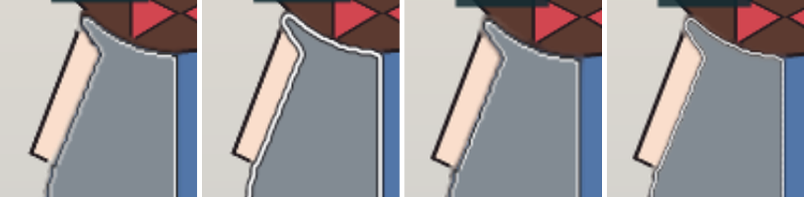

# 3-H 선택 테두리 다듬기 — 완료

1-B에서 미룬 일. 선택은 384×384 격자로 저장하는데, 테두리도 그 격자에 2칸 굵기로 그려 화면 크기로 늘렸다. 그래서 폰에서는 흐릿하고 계단이 보였다.

## 바꾼 것
- `masks.js` `maskContour`: 격자 값에서 경계선을 선분으로 뽑는다(살짝 고르게 한 뒤 칸 사이를 보간). `strokeContour`: 그 선을 **화면 해상도에서 일정한 굵기**(어두운 선 2.6 + 흰 선 1.2 화면픽셀)로 긋는다. 어떤 그림 위에서도 보이게 두 겹.
- 선택한 영역의 테두리(`overlay.js`)와, 고르는 중인 범위(마술봉·간략 범위지정)에도 같은 선을 긋는다. 고르는 중인 범위는 전에는 테두리가 없어 가장자리가 흐렸다.
- 저장 형식·격자(384)·선택 결과는 그대로. 테두리는 영역이 바뀔 때 한 번만 뽑아 둔다.

왼쪽 둘: 폰(3배 화면) 전 → 후. 오른쪽 둘: PC 전 → 후. 같은 자리 확대.

## 확인
- `run.js`(3-G 결과물과 비교): 달라진 스크린샷은 테두리가 나오는 4장(0.18~0.36%)뿐, 선택 결과·저장 왕복·동작 확인 동일, 오류 0.
- 옵션 슬라이더를 끄는 동안 테두리 그리기에 드는 시간: 전체 2.4초 중 0.005초 → 0.017초(영향 없음).
- `selop_check` 9단계, `shape_check` 11단계 통과. `build.js --check` 일치.
