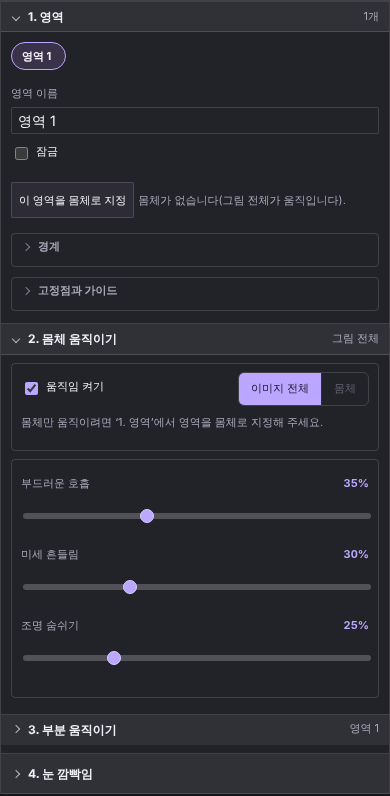

# 3-I 옵션 구성 정리(몸체 지정 = 완장) — 구현됨

합의안은 `3-I-plan.md`. 모양(색·글자·선·크기)은 손대지 않았다 → `docs/DESIGN-RULES.md` 단계에서 전체 일괄. 저장 형식 불변.

## 바꾼 것
- **1. 영역**: '범위 다듬기' 버튼 삭제(붓 도구와 중복). '▸움직일 몸체 지정' 묶음을 없애고, 영역마다 **몸체 지정 버튼**(이 영역을 몸체로 지정 ↔ 몸체 지정 해제)과 안내(지금 몸체: 이름 / 몸체 없음)를 둔다. **자동 크롭**은 몸체 영역을 골랐을 때만 버튼 옆에 나온다.
- **2. 몸체 움직이기**: 첫 상자에 **움직임 켜기**(이전 '전체 움직임 켜기')와 **[이미지 전체 / 몸체]**를 한 줄에. '몸체'일 때만 **몸체 경계 흐림**이 그 아래 나온다. 둘째 상자에 호흡·흔들림·조명.
  - [이미지 전체 / 몸체]는 기존 '배경 제외' 값(`base.exclude`) 그대로다.
  - 몸체 영역이 없으면 '몸체'는 고를 수 없고 안내가 나온다. 영역을 몸체로 지정하면 대상도 자동으로 '몸체'가 된다(전에는 '배경 제외'를 꺼 두었으면 꺼진 채였다).
  - 움직임을 끄면 고르기·효과가 흐려진다. 머리줄 오른쪽: 꺼짐 / 그림 전체 / 몸체: 이름.
- 묶음을 나누는 상자(`.optGroup`)는 임시로 기존 선 모양.

## 확인
- 조작 시험: 지정 → 해제 → 다시 지정 → 이미지 전체 → 움직임 끔 → 되돌리기, 단계마다 버튼·안내·대상·경계 흐림 표시가 맞음(폰·PC), 오류 0.
- `run.js`(3-H와 비교): 저장 왕복·선택 결과 동일, 동작 확인 5종 동일(몸체 지정 뒤 경계값 유지 포함), 성능 차이 없음, 오류 0.
- `schema_check`(영역 속성 저장·표시·조작·되돌리기): 완전히 같음. `selop_check`·`shape_check` 통과. `build.js --check` 일치.
- 검증 도구는 없어진 `basePanel`을 건너뛰게 고쳤다.

## 남은 것
- 전체 화면 스크린샷 검토(세 테마·폰/PC)는 디자인 규칙 단계에서 함께.
